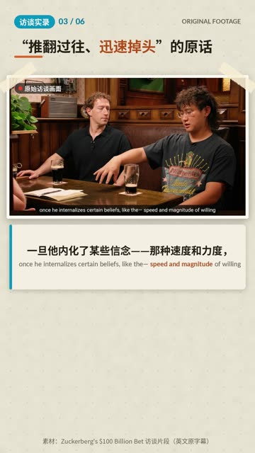
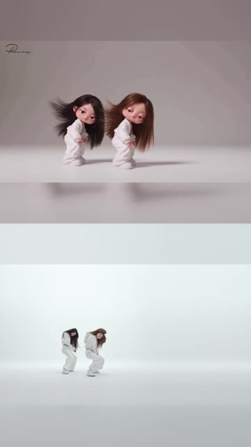
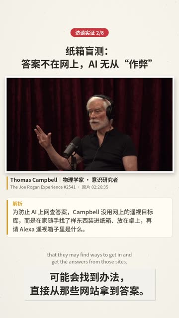
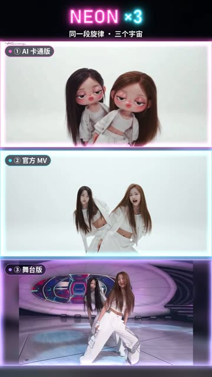
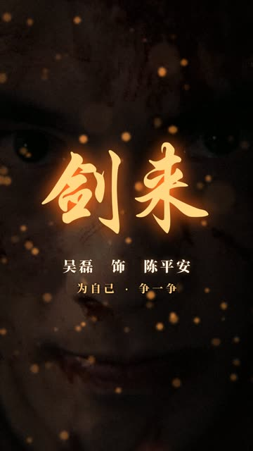
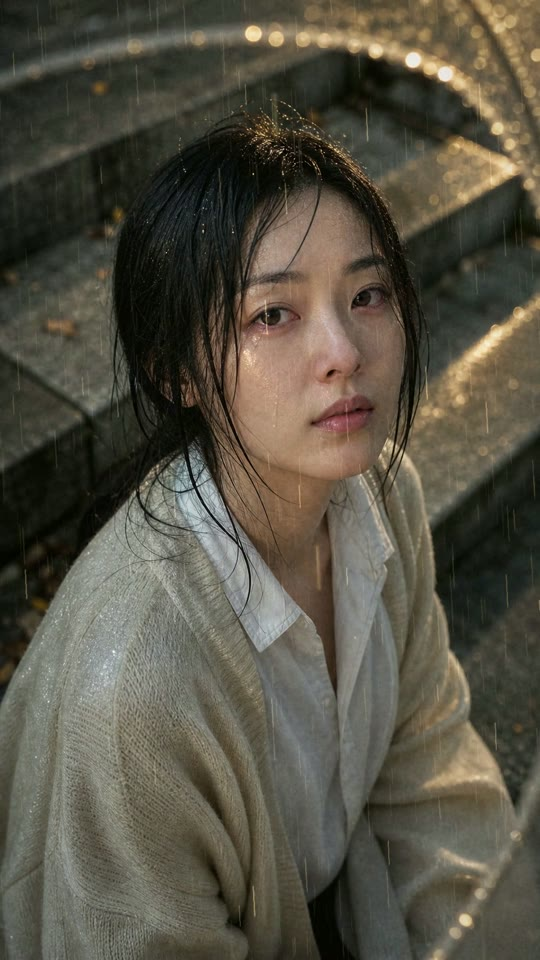
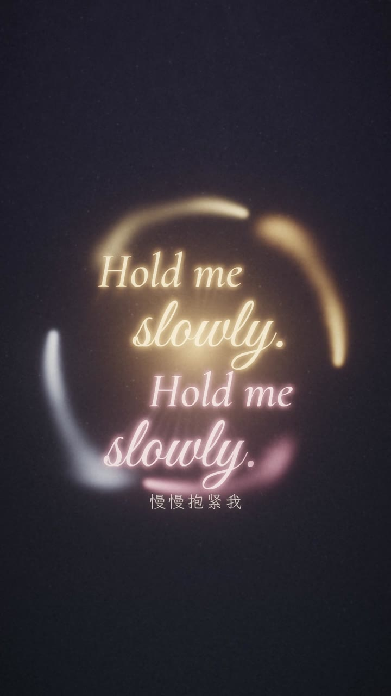
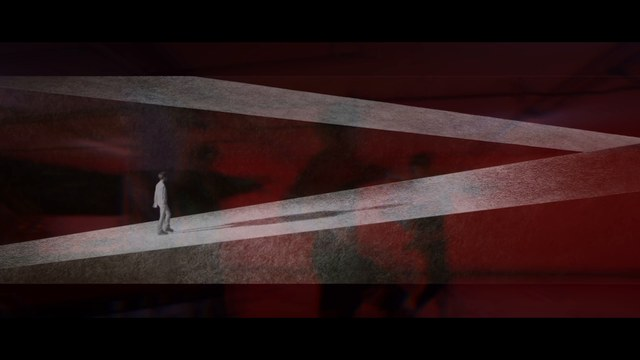
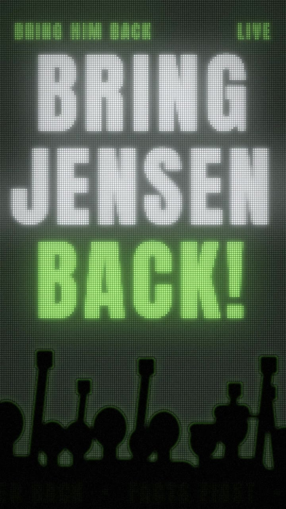

# Fun Videos · Anna

> 记录我用 AI 做科普 / 趣味短视频的学习过程：每个作品的**成片、素材、生成提示词、关键制作步骤和复盘**，以及从中沉淀下来、下次能直接用的**方法和脚本**。

**在线观看：<https://anna-sap.github.io/Fun-Videos-Anna/>**（成片可直接播放，附每支视频的制作历程）

<table>
<tr>
<td align="center"><a href="projects/2026-10-19-01-bayes-theory-x-interview/"></a><br><sub>贝叶斯 · 理论解析 × 访谈实录</sub></td>
<td align="center"><a href="projects/2026-10-21-01-neon-cartoon-vs-mv-split/"></a><br><sub>NEON · 卡通版 vs 原版分屏</sub></td>
<td align="center"><a href="projects/2026-10-21-02-ai-consciousness-evidence-cut/"></a><br><sub>AI 意识 · 访谈实证版</sub></td>
<td align="center"><a href="projects/2026-10-22-01-neon-three-universes/"></a><br><sub>NEON ×3 · 三个宇宙</sub></td>
<td align="center"><a href="projects/2026-10-24-01-neon-twin-tails/"></a><br><sub>NEON 双马尾 · AI 换发型</sub></td>
<td align="center"><a href="projects/2026-10-29-01-jianlai-wulei-highlight/"></a><br><sub>剑来 · 陈平安 · 吴磊高光</sub></td>
<td align="center"><a href="projects/2026-11-10-01-the-moment-you-saw-me/"></a><br><sub>The Moment You Saw Me · 歌曲 MV</sub></td>
<td align="center"><a href="projects/2026-11-12-01-hold-me-slowly/"></a><br><sub>Hold Me Slowly · 歌词 MV</sub></td>
<td align="center"><a href="projects/2026-11-13-01-winwin-mix-transitions/"></a><br><sub>WinWin 混剪 · 重做转场</sub></td>
<td align="center"><a href="projects/2026-11-14-01-bring-jensen-back/"></a><br><sub>Bring Jensen Back · 嘻哈 MV（第二版）</sub></td>
<td align="center"><a href="projects/2026-11-14-02-bring-jensen-back-led-wall/"></a><br><sub>Bring Jensen Back · LED 墙</sub></td>
</tr>
</table>

## 作品

| 日期 | 作品 | 做了什么 | 骨架素材 | 剪辑 |
|---|---|---|---|---|
| 2026-10-19 | [《非常贝叶斯》理论解析 × 访谈实录](projects/2026-10-19-01-bayes-theory-x-interview/) | 在理论解析片的论点之后插入 6 段扎克伯格访谈原话，配解析卡和「严谨注」，成片 2:08 | Gemini Notebook | Claude |
| 2026-10-21 | [NEON：AI 卡通版 vs 官方 MV](projects/2026-10-21-01-neon-cartoon-vs-mv-split/) | 用音频互相关精确对齐，做成 9:16 上下分屏（两种适配方式） | —（第三方素材） | Claude |
| 2026-10-21 | [《AI有意识吗》访谈实证版](projects/2026-10-21-02-ai-consciousness-evidence-cut/) | 在科普短片的 9 个节点插入 JRE #2541 访谈原声，配双语字幕和解析卡，成片 5:41 | Gemini Notebook + Clipchamp | Claude |
| 2026-10-22 | [NEON ×3：三个宇宙](projects/2026-10-22-01-neon-three-universes/) | AI 卡通版、官方 MV、舞台版三路音频对齐到同一个主时钟，按拍点网格在三分屏和全屏之间切换，成片 0:24.6 | —（第三方素材） | Claude |
| 2026-10-24 | [NEON 双马尾：给 AI 卡通版娃娃换发型](projects/2026-10-24-01-neon-twin-tails/) | 用 Kling 4.0 Video Edit 只改有头发的镜头，参考图让双马尾从第一帧开始；补回被抹掉的字样和签名，量出 Kling 的 1–2 帧延迟后对齐原片，配 MV 原声，成片 0:23.0 | Kling 4.0 Video Edit（Figma Weave） | Claude |
| 2026-10-29 | [剑来 · 陈平安：吴磊单人高光竖屏混剪](projects/2026-10-29-01-jianlai-wulei-highlight/) | 3:14 的剧集预告只留吴磊的单人镜头，用他本人的四句独白立人设；高潮段按实测 101.9 BPM 的重拍一拍一刀；9:16 窗口按脸取景、避开硬字幕，去水印，逐帧叠闪白、冲击缩放、RGB 错位、火星粒子和逐字字幕，成片 0:31.6 | —（第三方素材） | Claude |
| 2026-11-10 | [The Moment You Saw Me：同一场雨讲两遍](projects/2026-11-10-01-the-moment-you-saw-me/) | 一首 3:03 的英文歌的 MV。先量 BPM、段落和静默：后半首是前半首的原样重复，所以同一个雨天讲两遍；伴奏停掉的 0.44 秒里雨停在半空。34 张 AI 关键帧加景深视差运镜，雨由程序画。另有两个歌词版：歌词是手指写在起雾玻璃上的字；歌词是一扇窗投进场景里的光和影 | gpt-image-2 关键帧 + Depth Anything V2 | Claude |
| 2026-11-12 | [Hold Me Slowly：写在夜水里的字](projects/2026-11-12-01-hold-me-slowly/) | 一首 66 秒的歌的歌词 MV。用户只给了某工具识别的 SRT：先把人声分离出来，5 个 Whisper 模型交叉听写、给有分歧的词打分，再对着人声频谱图逐词对时间。画面全部由程序计算：歌词是滴进夜水里的发光的墨，唱完就松开散成烟；副歌里字被留住，冷暖两股墨被涡旋拉成一个光环 | —（全部程序生成） | Claude |
| 2026-11-13 | [WinWin 混剪：重做转场](projects/2026-11-13-01-winwin-mix-transitions/) | 别人剪的 69 秒混剪其实是三支 MV 首尾相接，接口处画幅、亮度、歌和调性同时硬切。让黑色遮幅跟着音乐“呼吸”（睁眼开场、落拍撑满、收成超宽银幕、闭眼收尾），三个接口分别用甩镜推入、回声残影（echo-out + 低音交接）、按亮度把雾溶解成烟（两首歌起音对齐的 25 帧）接过去，三段响度差从 4.4 LU 收到 1.1 LU | —（第三方素材） | Claude |
| 2026-11-14 | [Bring Jensen Back：一首嘻哈的“先要证据”](projects/2026-11-14-01-bring-jensen-back/) | 一首 4:35 的中英双语嘻哈（Suno 生成）的 MV，主角只有一张抠像。先从分离出的伴奏里量出鼓型：前 12 小节无鼓、第 29 小节伴奏全停、第 58 小节 Drop，就是片子最大的三个切。每个字在被唱出来的那一帧像橡皮章一样盖到画面上（中英混唱逐字对齐，每个字 12 个估计取中位数）；歌里那个人从不露脸，只以皮衣、空椅子和绿灯出现。第二版按反馈重做女主：她是歌里的"我们"（见证者），被每个场景自己的光照亮、被前景遮挡、和场景同一种成像方式，只在情绪落点走近，只有呼吸和重心摆动这样真实的动作 | —（用户提供的抠像，画面程序渲染） | Claude |
| 2026-11-14 | [Bring Jensen Back · LED 墙：一面不肯熄灭的灯墙](projects/2026-11-14-02-bring-jensen-back-led-wall/) | 同一首歌的另一个 Suno 版本（5:15）的歌词 MV。歌词取自 MP3 内嵌字段，实际演唱改写过的第二段主歌用 4 个识别模型听写、候选打分还原；画面是一面程序计算的 LED 点阵墙：字随演唱逐字点亮，墙的亮度跟着底鼓呼吸，低音抽空时跟着断电，副歌大字烧进墙里，片尾只剩一盏绿灯 | —（全部程序生成） | Claude |

科普片的工作模式基本固定为：**Gemini Notebook 生成解说骨架 → Claude 插入一手证据、核对事实、合成成片**。最新一支 MV 换了做法：**先把歌量清楚 → AI 关键帧 → 景深视差运镜和程序画的雨**。完整清单（每条视频的规格、大小、角色）见 [projects/README.md](projects/README.md)。

## 方法沉淀（playbooks）

| | |
|---|---|
| [证据插入式剪辑](playbooks/evidence-insert-editing.md) | 骨架 + 原声的完整流程，以及两次实践的对比 |
| [音频互相关对齐](playbooks/audio-sync-cross-correlation.md) | 毫秒级对齐两段视频；判断一段素材是从哪里剪出来的 |
| [本地语音识别与时间码](playbooks/local-asr-timestamps.md) | 中文旁白、英文词级时间码；没有 ASR 时从硬字幕读时间轴 |
| [竖屏 9:16 构图](playbooks/vertical-9x16-composition.md) | 完整画面 + 模糊填充 / 铺满裁切 / 相框嵌入 |
| [大文件与传输限制](playbooks/large-files-and-transfer-limits.md) | 源片太大、成片写不回、GitHub 100 MB 限制、写回文件的坑 |
| [AI 视频编辑](playbooks/ai-video-edit.md) | 只改一个属性、保住原片时间轴：选通道和报价、参考图、补回字样和签名、量帧延迟 |
| [提示词模式](playbooks/prompt-patterns.md) | 视频任务提示词该写什么，哪些漏写会返工 |

学习时间线和能力地图：[docs/learning-log.md](docs/learning-log.md)

## 仓库结构

```
.
├── README.md                  ← 你在这里
├── projects/                  每个作品一个目录：YYYY-MM-DD-NN-slug/
│   ├── README.md              作品索引
│   └── <作品>/
│       ├── README.md          作品卡：概况 · 成片 · 步骤 · 复盘
│       ├── prompt.md          提示词原文 · 后续交互 · 拆解 · 复用版
│       ├── media/             成片（Git LFS）
│       ├── materials/         自有素材，比如 AI 生成的骨架视频（Git LFS）及其旁白文稿
│       ├── variants/          同一题材的其他版本（可选）
│       ├── thumbs/            海报帧 + 逐帧预览
│       └── scripts/           这个作品用到的脚本
├── playbooks/                 跨作品可复用的方法
├── tools/
│   ├── av/                    find_offset.py（对齐）、contact_sheet.sh（缩略图）
│   ├── video-manifest.csv     视频清单：仓库路径 ↔ 本地文件名 + SHA-256
│   └── publish_videos_lfs.*   在本机把视频经 Git LFS 推上来
├── site/                      展示网站（GitHub Pages）：index.html 引用的视频由 build.mjs 打包
├── templates/project/         新作品模板
└── docs/
    ├── storage-policy.md      什么入库、怎么入库（LFS）、第三方素材登记
    └── learning-log.md        学习轨迹
```

## 新增一个作品

1. 复制 `templates/project/` 到 `projects/YYYY-MM-DD-NN-slug/`
2. 在 `prompt.md` 里原样粘贴提示词和后续交互
3. 在 `README.md` 里写步骤和复盘；用 `tools/av/contact_sheet.sh` 生成缩略图
4. 在 `tools/video-manifest.csv` 里给成片和自有素材各加一行，然后在本机双击 `publish_videos_lfs.bat` 上传
5. 更新本页的作品表、`projects/README.md` 和 `docs/learning-log.md`；有可复用的方法就补进 `playbooks/`
6. 在 `site/index.html` 里加上这个作品（视频用仓库路径 `projects/...` 引用），推送后网站会自动重新部署。本地预览：`node site/build.mjs && node site/serve.mjs`

## 克隆

视频用 Git LFS 存储（[说明](docs/storage-policy.md)）：

```bash
git lfs install
git clone https://github.com/Anna-SAP/Fun-Videos-Anna.git
# 只要文档、不下载视频：
GIT_LFS_SKIP_SMUDGE=1 git clone https://github.com/Anna-SAP/Fun-Videos-Anna.git
```

## 素材与版权

本库只用于个人学习记录。第三方原始素材（访谈整集、访谈录屏、官方 MV、歌曲原曲和歌词文件、其他创作者的作品）**不入库**，只在 [docs/storage-policy.md](docs/storage-policy.md) 里登记来源。部分成片含有这些素材的片段，版权归原作者所有。
