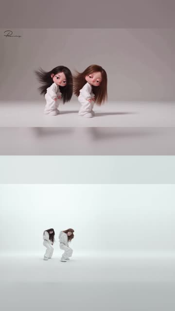
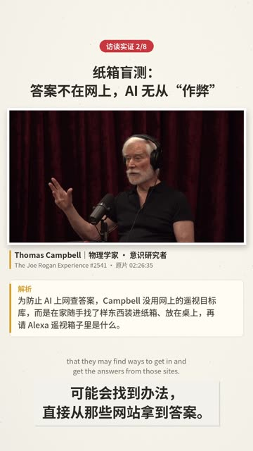

# Fun Videos · Anna

> 记录我用 AI 做科普 / 趣味短视频的学习过程：每个作品的**成片、生成提示词、关键制作步骤和复盘**，以及从中沉淀下来、下次能直接用的**方法和脚本**。

<table>
<tr>
<td align="center"><a href="projects/2026-10-21-01-gemini-notebook-ai-consciousness/"></a><br><sub>01 方案三</sub></td>
<td align="center"><a href="projects/2026-10-21-01-gemini-notebook-ai-consciousness/"></a><br><sub>01 方案四</sub></td>
<td align="center"><a href="projects/2026-10-21-01-gemini-notebook-ai-consciousness/"></a><br><sub>01《AI有意识吗》</sub></td>
<td align="center"><a href="projects/2026-10-21-02-neon-cartoon-vs-mv-split/"></a><br><sub>02 NEON 分屏</sub></td>
<td align="center"><a href="projects/2026-10-21-03-ai-consciousness-evidence-cut/"></a><br><sub>03 访谈实证版</sub></td>
</tr>
</table>

## 作品

| 日期 | 作品 | 做了什么 | 工具 |
|---|---|---|---|
| 待补充 | 贝叶斯主题视频 | ⏳ 待归档 | |
| 2026-10-21 | [01 · 《意识与虚拟现实的本质》方案三 / 四 → 《AI有意识吗》](projects/2026-10-21-01-gemini-notebook-ai-consciousness/) | AI 生成两版竖屏科普短片，再拼接成 2:22 的完整论证 | Gemini Notebook、Clipchamp |
| 2026-10-21 | [02 · NEON：AI 卡通版 vs 官方 MV](projects/2026-10-21-02-neon-cartoon-vs-mv-split/) | 音频互相关精确对齐，做成 9:16 上下分屏（两种适配） | Claude、ffmpeg |
| 2026-10-21 | [03 · 《AI有意识吗》访谈实证版](projects/2026-10-21-03-ai-consciousness-evidence-cut/) | 在科普短片的 9 个节点插入访谈原声，配双语字幕和“解析”卡，成片 5:41 | Claude、ffmpeg、sherpa-onnx |

完整清单（每条成片的规格和大小）：[projects/README.md](projects/README.md)

## 方法沉淀（playbooks）

| | |
|---|---|
| [音频互相关对齐](playbooks/audio-sync-cross-correlation.md) | 毫秒级对齐两段视频；判断一段素材是从哪里剪出来的 |
| [本地语音识别与时间码](playbooks/local-asr-timestamps.md) | 不依赖平台字幕，拿到中文旁白和英文词级时间码 |
| [竖屏 9:16 构图](playbooks/vertical-9x16-composition.md) | 完整画面 + 模糊填充 / 铺满裁切 / 相框嵌入 |
| [证据插入式剪辑](playbooks/evidence-insert-editing.md) | 切点、音频门控、溶解、响度、版式、事实核对 |
| [大文件与传输限制](playbooks/large-files-and-transfer-limits.md) | 源片太大、成片写不回、GitHub 100 MB 限制 |
| [提示词模式](playbooks/prompt-patterns.md) | 视频任务提示词该写什么，哪些漏写会返工 |

学习时间线和能力地图：[docs/learning-log.md](docs/learning-log.md)

## 仓库结构

```
.
├── README.md                  ← 你在这里
├── projects/                  每个作品一个目录：YYYY-MM-DD-NN-slug/
│   ├── README.md              项目索引
│   └── <项目>/
│       ├── README.md          项目卡：概况 · 成片 · 步骤 · 复盘
│       ├── prompt.md          提示词原文 · 后续交互 · 拆解 · 复用版
│       ├── media/             成片（Git LFS）
│       ├── thumbs/            海报帧 + 逐帧预览
│       ├── scripts/           这个项目用到的脚本
│       └── transcripts/       旁白文稿
├── playbooks/                 跨项目可复用的方法
├── tools/
│   ├── av/                    find_offset.py（对齐）、contact_sheet.sh（缩略图）
│   ├── video-manifest.csv     视频清单：仓库路径 ↔ 本地文件名 + SHA-256
│   └── publish_videos_lfs.*   在本机把视频经 Git LFS 推上来
├── templates/project/         新项目模板
└── docs/
    ├── storage-policy.md      什么入库、怎么入库（LFS）、第三方素材登记
    └── learning-log.md        学习轨迹
```

## 新增一个作品

1. 复制 `templates/project/` 到 `projects/YYYY-MM-DD-NN-slug/`
2. 在 `prompt.md` 里原样粘贴提示词和后续交互
3. 在 `README.md` 里写步骤和复盘；用 `tools/av/contact_sheet.sh` 生成缩略图
4. 在 `tools/video-manifest.csv` 里加一行，然后在本机双击 `tools/publish_videos_lfs.bat` 上传视频
5. 更新本页的作品表、`projects/README.md` 和 `docs/learning-log.md`；有可复用的方法就补进 `playbooks/`

## 克隆

视频用 Git LFS 存储（[说明](docs/storage-policy.md)）：

```bash
git lfs install
git clone https://github.com/Anna-SAP/Fun-Videos-Anna.git
# 只要文档、不下载视频：
GIT_LFS_SKIP_SMUDGE=1 git clone https://github.com/Anna-SAP/Fun-Videos-Anna.git
```

## 素材与版权

本库只用于个人学习记录。第三方原始素材（访谈整集、官方 MV、其他创作者的作品）**不入库**，只在 [docs/storage-policy.md](docs/storage-policy.md) 里登记来源。部分成片含有这些素材的片段，版权归原作者所有。
