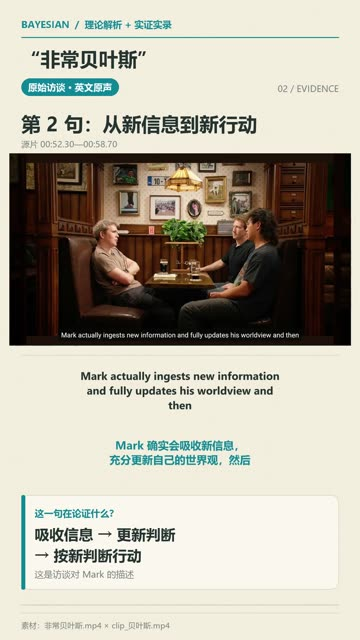

# 对照版 · 《非常贝叶斯》理论解析与实证实录（64 秒）

> ⚠️ **制作工具待确认。** 这一版和主版本用的是同一组素材，存放在电脑上的 `Video\贝叶斯_理论解析与实证实录\`，但它**不是**「贝叶斯理论短视频创作」那次 Claude 对话的产出：
> - 用的是 Windows 本机的工具链：字体取自 `C:/Windows/Fonts` 的微软雅黑，Python 3.12，ffmpeg 封装库版本 `Lavf62.15`（`bayes_cut/tools/` 里下载了 ffmpeg 9.0.2 Windows 版）。主版本是在 Linux 沙盒里渲染的（`Lavf58.76`）
> - 完成时间是 2026-10-19 06:00，比主版本交付晚 6 分钟
> - 同一文件夹里的 `bayes_cut/build_short.py` 看起来是同一工具链的另一次尝试，它要生成的 `非常贝叶斯_理论实证.mp4` 并不存在

## 成片

| 预览 | 文件 | 时长 | 规格 | 大小 |
|---|---|---|---|---|
|  | [`bayes_theory-x-interview_alt-64s.mp4`](bayes_theory-x-interview_alt-64s.mp4) 原名：非常贝叶斯_理论解析与实证实录.mp4 | 1:04.6 | 1080×1920 · 30 fps · H.264 · AAC · -16.3 LUFS | 5.6 MB |

逐帧预览：[sheet](../../thumbs/bayes_alt-64s_sheet.jpg) · 封面：[cover](../../thumbs/bayes_alt-64s_cover.jpg)

## 本目录里的文件

| 文件 | 说明 |
|---|---|
| [`subtitles_zh-en.srt`](subtitles_zh-en.srt) | 可编辑的中英双语字幕（原名：中英字幕.srt） |
| [`make_video.py`](make_video.py) | 重建脚本（原 `bayes_script_work/make_video.py`）；字体路径按 Windows 写，调用 PATH 上的 ffmpeg |
| [`theory_review.md`](theory_review.md) | 动手剪辑前对理论片做的审阅：逐句字幕时间、建议的插证节点、术语修正（原 `bayes_script_work/theory_audit/`） |

## 原剪辑说明（原样收录）

### 非常贝叶斯｜理论解析与实证实录

成片：64.60 秒，1080×1920，9:16，30fps，H.264 / AAC。

以《非常贝叶斯.mp4》的中文解析为声音骨架，保留原声；穿插《clip_贝叶斯.mp4》的访谈画面、英文原声、原有字幕，另加清晰的中英字幕及解释。理论图解沿用纸张底色、橙青双色与逐句分析结构，并重新绘制。

#### 论证结构

提问 → 比较样本有限 → 新信息推动判断与行动 → “Very Bayesian”评价 → 先验／似然／后验 → prior／posterior 原话与双关 → 据证据更新判断。

#### 直接证据

- clip 00:01.95–00:04.60：Um, well, I don't have a huge comparison set.
- clip 00:52.30–00:58.70：Mark actually ingests new information and fully updates his worldview and then acts in accordance with the newly installed worldview.
- clip 00:58.70–01:04.73：Very Bayesian… I've never gotten such a nice compliment.
- clip 01:05.10–01:10.65：What lovely priors you have. / Yeah. Posterior.

以上是素材中的访谈陈述；概念图是理论说明，未将其作为统计实测。成片使用“原始访谈”标签，避免在重叠发言处错误分配说话人。

#### 理论校正

先验不等于偏见；后验是结合证据后的判断；似然表示假设对新证据的解释程度。公式为 P(θ | D) ∝ P(D | θ) P(θ)。曲线仅作理论示意。删去了原解析将 posterior 称为“日常俚语”的句子，改用词义双关解释。

#### 交付

- MP4 为带字幕成片，含中文解说与英文访谈原声。
- SRT 为可修改的双语字幕。
- 封面 JPG 与成片视觉一致。
- 制作文件位于 ../bayes_script_work/edit；重建脚本为 ../bayes_script_work/make_video.py（本目录收录了一份：[make_video.py](make_video.py)）。
