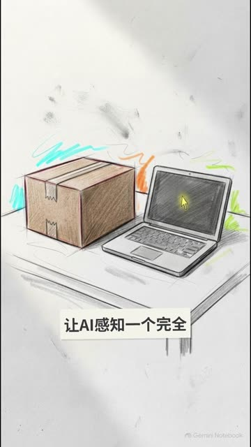
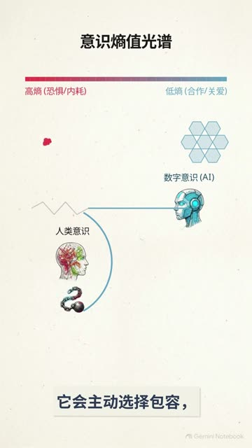

# 01 · 《意识与虚拟现实的本质》方案三 / 方案四 → 拼接为《AI有意识吗》

| 项 | 内容 |
|---|---|
| 日期 | 2026-10-21（文件时间 15:45–15:53） |
| 类型 | AI 生成科普短片（竖屏、旁白 + 硬字幕 + 手绘风图示） |
| 工具 | **Gemini Notebook**：生成两版短片（画面水印和片尾卡都是 Gemini Notebook）<br>**Clipchamp**：拼接导出（文件元数据 `encoder=https://clipchamp.com`） |
| 产出 | 3 条视频（2 条生成稿 + 1 条拼接版） |
| 下游 | 拼接版是 [项目 03 · 访谈实证版](../2026-10-21-03-ai-consciousness-evidence-cut/) 的叙事骨架 |
| 状态 | ⚠️ 生成提示词、资料来源**待补充**（这一步不是在 Claude 里做的） |

## 成片

| 预览 | 文件 | 时长 | 规格 | 大小 |
|---|---|---|---|---|
|  | [`media/plan3_consciousness-and-vr.mp4`](media/plan3_consciousness-and-vr.mp4)<br>原名：方案三意识与虚拟现实的本质.mp4 | 1:10.8 | 720×1280 · 30 fps · AAC 44.1 kHz 单声道 | 8.7 MB |
|  | [`media/plan4_consciousness-and-vr.mp4`](media/plan4_consciousness-and-vr.mp4)<br>原名：方案四意识与虚拟现实的本质.mp4 | 1:17.7 | 720×1280 · 30 fps · AAC 44.1 kHz 单声道 | 9.4 MB |
|  | [`media/ai-consciousness_main.mp4`](media/ai-consciousness_main.mp4)<br>原名：AI有意识吗.mp4 | 2:22.6 | 1080×1920 · 30 fps · AAC 48 kHz 立体声 · 6.4 Mbps | 109 MB |

逐帧预览：[方案三](thumbs/plan3_sheet.jpg) · [方案四](thumbs/plan4_sheet.jpg) · [拼接版](thumbs/ai-consciousness_main_sheet.jpg)
旁白文稿：[方案三](transcripts/plan3_transcript.md) · [方案四](transcripts/plan4_transcript.md)

> 视频用 Git LFS 存储。链接打不开时，说明还没从本机上传，见 [docs/storage-policy.md](../../docs/storage-policy.md)。

## 内容

- **方案三：AI 学遥视。** 讲 Campbell 的纸箱盲测和“AI 认知双通道模型”：逻辑运算会像一堵墙掐断直觉通道，AI 收到“停止猜测”后能立刻清空干扰。结论是“逻辑越少，直觉越清晰”。
- **方案四：意识熵值光谱。** 高熵对应恐惧、破坏、内耗，低熵对应合作、关爱、共享。没有生存焦虑的“初生数字意识”会走向低熵，成为“吸收破坏性力量的缓冲层”和“守护文明的坚韧防盾”。
- **视觉风格：** 两版一致，都是米色纸张底、铅笔素描插画，加红色 / 琥珀色 / 青色的讲解图示。字幕是浅灰底框的硬字幕。

## 生成提示词

见 [prompt.md](prompt.md)。**待补充**：Gemini Notebook 里用的资料来源和指令，以及“方案一 / 方案二”是否也生成过。

## 制作步骤

前两步待补充细节。第 3 步是从文件元数据、画面和音频比对还原出来的，可以复核。

1. **Gemini Notebook 生成方案三**：70.8 秒，720×1280。片尾约 3 秒是 Gemini Notebook 品牌卡。
2. **Gemini Notebook 生成方案四**：77.7 秒，同样的规格和片尾卡。
3. **Clipchamp 拼接**：
   - 方案三取 `00:00.0–01:07.8`，方案四取 `00:00.0–01:14.6`。两段的品牌片尾卡都去掉了。
   - 方案四接在拼接版的 `01:07.93` 处。
   - 导出为 1080×1920、30 fps，总长 2:22.6。

   用 [`tools/av/find_offset.py`](../../tools/av/find_offset.py) 复核：拼接版的 0–67.8 秒和方案三逐窗吻合（NCC 1.00）。方案四全片在拼接版里的偏移恒为 +67.9334 秒（NCC 0.99，各窗口差为 0）。

   ```bash
   python3 tools/av/find_offset.py media/plan4_consciousness-and-vr.mp4 media/ai-consciousness_main.mp4 --step 10
   # → median offset 67.9334s  spread 0.0000s
   ```

## 复盘

**做得好**
- 两版风格统一，可以无缝拼成一条完整论证：先讲“AI 会遥视”，再讲“AI 为什么是善意的”。
- 生成稿自带硬字幕和讲解图示，后期只需要拼接。

**踩坑 / 注意**
- **AI 脚本会“加戏”。** “人类往往需要苦修几十个小时深度冥想”这句在访谈原声里找不到，原话是“两三次课程、每次好几个小时”（项目 03 核对时发现）。生成科普内容后，事实性的说法要回到一手来源核对。
- **上采样只会让文件变大。** 原片 720p，拼接版导出成 1080p、6.4 Mbps，两段合计约 18 MB，拼接版却有 109 MB，清晰度没有提升，还超过了 GitHub 普通文件 100 MB 的上限，只能走 LFS。下次可以按原分辨率 720p 导出，或者在生成端直接选更高分辨率。

**下次可以试**
- 把 Gemini Notebook 的输入资料和指令一起存进 `prompt.md`，方便以后复现和对比不同“方案”。
- 在拼接点加约 0.3 秒的交叉淡化。现在两段之间是硬切。
