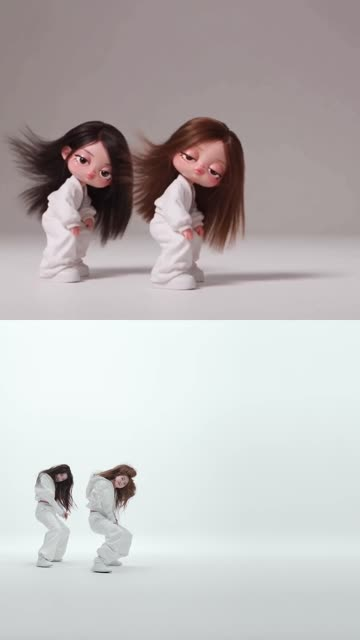

# 2026-10-21 · NEON：AI 卡通版 vs 官方 MV · 9:16 上下分屏

| 项 | 内容 |
|---|---|
| 日期 | 2026-10-21 |
| 类型 | 对比剪辑（竖屏上下分屏，音画同步） |
| 工具 | Claude（对话里完成）+ ffmpeg、numpy/scipy（音频互相关） |
| 产出 | 2 条成片：完整画面版、铺满裁切版 |
| 对话 | claude.ai「9:16 split-screen video comparison」，在本 Project 内 |

## 成片

| 预览 | 文件 | 时长 | 规格 | 大小 |
|---|---|---|---|---|
|  | [`media/neon_split_fit.mp4`](media/neon_split_fit.mp4) 原名：NEON_卡通vs原版_9x16分屏_完整画面.mp4 | 0:23.1 | 1080×1920 · 30 fps · H.264 CRF 18 · AAC 192 kbps | 12.0 MB |
|  | [`media/neon_split_crop.mp4`](media/neon_split_crop.mp4) 原名：NEON_卡通vs原版_9x16分屏_铺满裁切.mp4 | 0:23.1 | 同上 | 14.7 MB |

逐帧预览：[完整画面](thumbs/neon_split_fit_sheet.jpg) · [铺满裁切](thumbs/neon_split_crop_sheet.jpg)

**两个版本只是画面适配方式不同：**
- **完整画面（fit）**：每一半都保留完整的 16:9 画面，上下空出的部分用同一画面放大、模糊、压暗后填充。适合看清所有成员的动作。
- **铺满裁切（crop）**：每一半都居中裁切铺满 1080×960。竖屏上冲击力更强，但左右两侧会被裁掉，比如「A2O LITE」字样和群舞时最边上的成员。

## 输入素材（不入库）

| 素材 | 说明 | 为什么不入库 |
|---|---|---|
| 卡通版片段 | Higgsfield 创作者用 AI 重绘的 A2O LITE《NEON》开头，约 23 秒、30 fps。音频只有 74 kbps，约 22.5 秒后就没声了。原文件名带 `#higgsfieldcreator … Made @higgsfield.ai` | 第三方作品 |
| 官方 MV | `A2O LITE 'NEON' Official Video.mkv`，201 MB，23.976 fps | 第三方版权，体积也大 |

## 提示词

见 [prompt.md](prompt.md)，是原样记录的。

## 关键制作步骤

1. **用音频找对齐点**（[playbook](../../playbooks/audio-sync-cross-correlation.md)）
   - 先把两路音频转成 8 kHz 单声道，做全局归一化互相关（NCC），粗定位卡通版在 MV 里的位置。
   - 再转成 16 kHz，用 1.5 秒窗口每隔 0.5 秒滑动、逐窗复核，同时屏蔽静音段，防止静音“抢”到匹配。
   - 结果：卡通版就是 MV 开头的 0:00–0:23，`MV 时间 = 卡通版时间 − 0.0407 s`，全段偏移一致，没有漂移。
2. **用画面复核**：把两路视频缩到 64×36 灰度，计算帧差信号再做相关；同时对照镜头切点，并拼 9 组对照帧检查。比如 16 秒处的 A2O 标志，上下两边在同一帧出现。
3. **合成**：脚本见 [`scripts/render_split_9x16.sh`](scripts/render_split_9x16.sh)（[竖屏构图 playbook](../../playbooks/vertical-9x16-composition.md)）
   - MV 那一路用 `tpad=start_duration=0.0407:start_mode=clone` 在开头补帧对齐，两路统一成 30 fps。
   - fit 版：前景缩放到 1080 宽，背景是同一画面 `scale→crop→gblur σ28→压暗 6%`。crop 版：`scale=increase` 后 `crop=1080:960`。最后两半 `vstack`。
4. **音轨**：用 MV 原声。卡通版音质低，结尾还提前静音。MV 音轨 `adelay` 0.0407 秒（1954 个采样点，48 kHz），结尾淡出 0.4 秒。
5. **验证**：成片音频再和卡通版逐段做互相关，上下两路偏差约 7 ms，不到一帧。

## 复盘

**做得好**
- **用音频而不是画面做对齐基准。** AI 重绘会改变个别镜头的内容和切点，比如约 7 秒处卡通版是拳头特写，原版是两人指向镜头，但音乐节拍不会变。
- **先粗后细。** 全局定位之后再滑窗逐段复核，一次就能同时排除“偏移不对”和“越播越偏”。
- 同时交付两种画面适配，让使用场景来决定选哪个。

**踩坑 / 注意**
- 卡通版自带的音轨提前结束，如果用它当音轨，结尾会出现约 0.5 秒的静音。合成前要先比对两路音轨的电平和长度。

**下次可以试**
- 在两半画面上加「AI 卡通版 / 原版 MV」角标（当时提出过，没做）。
- 加中间分隔线或者左右对比版本，测试一下哪种在手机上看更清楚。
