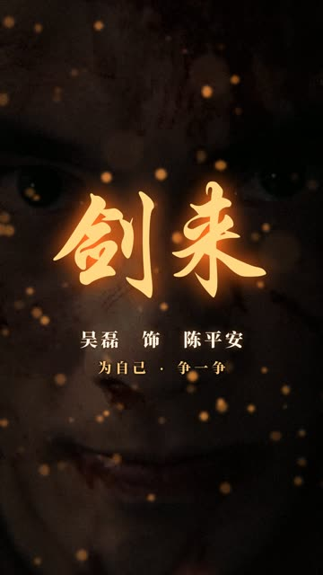

# 2026-10-29 · 剑来 · 陈平安：吴磊单人高光竖屏混剪

| 项 | 内容 |
|---|---|
| 日期 | 2026-10-29 |
| 类型 | 预告片 → 9:16 人物卡点混剪 |
| 工具 | Claude Code（本机）+ ffmpeg、numpy/scipy、Pillow |
| 输入 | 《剑来》最新预告（腾讯视频，3:14），第三方素材，不入库 |
| 产出 | 1 条成片 + 1 条 60 秒[加长版](variants/60s/) |
| 对话 | Claude 桌面版 Code 会话 |

## 成片

| 预览 | 文件 | 时长 | 规格 | 大小 |
|---|---|---|---|---|
|  | [`media/jianlai_wulei-highlight.mp4`](media/jianlai_wulei-highlight.mp4)<br>原名：剑来_吴磊高光_9x16.mp4 | 0:31.6 | 1080×1920 · 25 fps · H.264 CRF 20（上限 14 Mbps）· AAC 192 kbps · −14.1 LUFS / −2.8 dBTP | 54.5 MB |

逐帧预览：[成片](thumbs/jianlai_wulei-highlight_sheet.jpg) · [取景示意](thumbs/jianlai_wulei-highlight_framing.jpg)（原片画面上的 9:16 取景框）

**一句话：** 3 分 14 秒的预告只留陈平安（吴磊）的单人镜头，用他自己的独白「去路不由己，但我还是想，为自己，争一争」立住性格，再接预告高潮段的配乐按重拍切，最后以浴血特写、一拍静默和「剑来」标题收尾。

## 剪辑清单

成片时间 → 原片时间。一共用了原片的 20 个镜头，有几个在快闪段重复出现；除了「落锤火花」是他锤子落下的插入镜头，其余都能看清是吴磊本人。

| 成片 | 段落 | 画面（原片时间） | 声音（原片时间） |
|---|---|---|---|
| 0:00–0:01 | 钩子 | 三连快闪 0.33 秒一刀：火星爆发出拳（2:53）、浴血咬牙（2:54）、仰头咳血（2:16），闪白 + 切片错位 + RGB 错位 | 1:56.3 起的环境声 + 合成冲击、电流声 |
| 0:01–0:10 | 独白 | 低头流血（1:56）→ 汗湿抬眼（1:58）→ 脱衣转身、火星四溅（1:59.5）→ 锻打（2:02）→ 肩背（2:04）→ 举锤慢放 0.68×（2:05）→ 落锤火花（2:05.7） | 1:56.3–2:06.3 原声，四句独白，字幕逐字落下；「争一争」砸进画面 |
| 0:10–0:19 | 高潮，一拍一刀 | 雨中直视「见自由」（2:27）→ 斗笠仰望（0:50）→ 碎石中背影（0:58）→ 碎石中正脸（1:00）→ 山道远眺慢放 0.6×（0:48）→ 雾中被掀飞（2:15）→ 咳血（2:16.5）→ 泥地侧脸（2:21）→ 门缝（2:22.5）→ 火光侧脸（0:42） | 2:26.96–2:39.89 原声，切点落在每 1.1775 秒的重拍上 |
| 0:19–0:22 | 提速 | 8 个镜头各 0.29 秒（四分之一个重拍），然后举手推近（1:08） | 同上 + 合成上扬音 |
| 0:23–0:28 | 收尾 | 火星爆发出拳，慢放 0.74×，镜头从拳头甩到脸（2:52.3）→ 浴血特写（2:53.8）→ 原片静默处慢放 0.25×、褪色、推近（2:56.4） | 2:51.84 起原声，含原片的那一拍静默 |
| 0:28.4–0:31.6 | 片尾 | 浴血特写定格压暗，「剑来」行楷标题砸入，「吴磊 饰 陈平安」「为自己 · 争一争」 | 原片标题重击（2:57.3）+ 合成低频 |

## 第三方素材（不入库，只登记）

| 素材 | 说明 | 本地文件 / 体积 |
|---|---|---|
| 《剑来》最新预告 | 吴磊主演，腾讯视频出品；1920×1080、25 fps、3:14.14；画面在 x 150–1770（两侧黑边），中英硬字幕在 y 895–985，右上角有「腾讯视频」水印 | `吴磊《剑来》最新预告.mp4` / 78.7 MB |

## 提示词

见 [prompt.md](prompt.md)。

## 关键制作步骤

1. **逐镜头认人。** 1 fps 缩略图拼图看全片，再在可疑段落按 4 fps 细看，标出每个镜头的起止（`scdet` 漏掉了暗场和叠化，靠拼图补）。排除了：白衣长发少年（2:23，另一位演员）、斗笠持剑特写（2:38–2:41，只露下半张脸，无法确认是吴磊）、2:42–2:50 的角色出场卡、2:31–2:35 的双人打斗、1:08 背景里的旁人（取景时裁掉）。
2. **台词只留他本人的。** 从硬字幕读出每句台词的时间，再用声谱图确认人声的起止：
   - 「去路不由己」117.5 s、「但我还是想」119.5 s、「为自己」121.1 s、「争一争」122.9 s、「见自由」147.3 s。
   - 「见天地」（女声，146.0 s）、「出来」「给我斩开这方天地」（168.5–170.9 s）都是别人的台词，音频分段时避开。
3. **找卡点网格。** 自己写的 spectral flux 起音检测 + 自相关：高潮段（2:21–2:56）是 101.9 BPM，强拍每 1.1775 秒一个，起点 141.07 s；147–160 s 之间的强起音几乎都落在这个网格上。高潮段第二截从 171.84 s 起（原片在这里切到吴磊、有一个起音），跳过中间的女声台词。
4. **竖屏取景。** 9:16 窗口只有原画面宽度的 37.5%，每个镜头按脸的位置定 `cx`；有硬字幕的镜头用 888 px 高的窗口贴着画面顶端取景，底边停在字幕上方，原片字幕永远不进画面。斗笠、门缝这类本来就居中的镜头直接用；出拳那个镜头拳头和脸离得太远，做成 0.5 秒的甩镜：先拍拳头，再甩到脸上。
5. **去水印。** 「腾讯视频」水印在 x 1487–1790、y 50–128，火光侧脸和出拳镜头的窗口会碰到。每个镜头解码时先过 ffmpeg `delogo`，再交给合成脚本。
6. **逐帧合成。** Python 读原片帧，按剪辑表裁切缩放，再叠特效：
   - 冲击缩放、抖动、RGB 错位、闪白，按切点设强度；钩子段加切片错位；0:10 的转场用径向变焦模糊。
   - 锻造段和收尾段叠火星粒子；整体略提对比和饱和，加暗角和颗粒。
   - 字幕用思源宋体 Heavy，逐字缩放落下，英文小字跟在下面；「争一争」整体砸入，「见自由」竖排放在脸旁边。片头角标和片尾标题用华文行楷。
   - 快闪段 8 刀只给很弱的闪白（0.10），钩子段 3 次也控制在 0.55 以下，避免频闪。
7. **声音。** 三段原声按 12 ms 交叉淡化拼接，叠合成音效：冲击（低频扫频 + 噪声体 + 尾音）、风声、电流声、上扬音，静默处加两下心跳低频。软削波后两遍 `loudnorm` 线性归一到 −14 LUFS，再过 −2 dB 限幅：只靠 `loudnorm` 时 AAC 编码后真峰值还有 −0.7 dBTP。
8. **先预览再出片。** 540×960 预览一分半出来，看拼图改了取景（锻打、火光侧脸）、片尾淡出没盖住文字、宋体缺空格和间隔号字形（显示成方块）这几处，再出全分辨率。
9. **压码率。** 第一版全分辨率用 CRF 18 出了 123 MB（31 Mbps）：每帧都是新的胶片颗粒，编码器把码率全花在噪声上。改成 CRF 20 加 14 Mbps 上限后是 54.5 MB，和 CRF 18 版逐帧比 PSNR 约 36 dB，肉眼看不出差别。
10. **验证。** 成片 790 帧，正好 31.6 秒；24 张抽帧逐张看过，没有原片字幕、水印或其他角色；预览版音频（混音流程和成片相同，只差最后的响度处理）做过起音检测，强起音和剪辑表里的切点一致。

复现：

```bash
python scripts/render_jianlai_wulei.py "吴磊《剑来》最新预告.mp4" 剑来_吴磊高光_9x16.mp4 --scale 0.5 --fast   # 预览
python scripts/render_jianlai_wulei.py "吴磊《剑来》最新预告.mp4" 剑来_吴磊高光_9x16.mp4                   # 成片
python scripts/render_jianlai_wulei.py "吴磊《剑来》最新预告.mp4" x.mp4 --frames 1.6,10.6,28.6            # 只出几张静帧检查
```

## 复盘

**做得好**
- **用他自己的话立人设。** 「刚毅果决」靠画面不容易说清；四句独白本来就是这个性格，用它做骨架，画面跟着台词走，再接高潮段的纯音乐，前后两种节奏。
- **网格是量出来的。** 高潮段的切点落在实测的 1.1775 秒重拍上，成片音频再做一次起音检测，强起音和切点对得上（10.00、11.18、13.04、13.70、17.06、18.29…）。
- **宁缺毋滥。** 认不出是谁的镜头不用，别人的台词不进成片；硬字幕和水印在取景、解码阶段就处理掉，不靠后期遮挡。

**踩坑 / 注意**
- **`scdet` 漏切点：** 预告里大量叠化和暗场，102–124 s 之间一个切点都没报出来。认镜头还是要看拼图。
- **水印的位置要量，不要估。** 一开始按缩略图估成 x 1600 起，实际从 1487 起，火光侧脸的取景把水印图标带进了画面；放大到像素级量一次再定 `delogo` 区域。
- **思源宋体 Heavy 没有半角空格和「·」的字形，** 会画成方块。自己画间隔点、空格按字号的 0.4 倍留白。
- **加了胶片颗粒就要限码率：** 随机颗粒每帧都不一样，CRF 18 下码率翻了一倍多，超过 GitHub 单文件 100 MB 的限制，也不适合手机上传。
- **Windows 上读 ffmpeg 日志要指定 UTF-8：** 日志里有中文路径，`text=True` 按 GBK 解码失败时 `subprocess.run` 返回的 stderr 是 `None`，两遍 `loudnorm` 第一次就是这样挂的。
- **原片的竖屏潜力有限：** 浴血特写本来就是大特写，9:16 只能拍到眼睛到下巴；有字幕的镜头放大 2.2 倍，画面会软一些，加了轻度锐化。

**下次可以试**
- 发布前在抖音 / 视频号的真实界面上看一遍字幕和底部按钮的位置。
- 要更清晰的竖屏，可以找 4K 源，或者试 AI 超分。
- 片头钩子可以做成两个版本（快闪 / 直接台词开场），看哪个完播率高。

## 60 秒加长版

后来又做了一条 60 秒的：[variants/60s/](variants/60s/)。规则不变，前面加了他的另一段独白「我原以为……可这方天地，当真如我所见」，配屋檐、火光、狗、烧窑、山道、斗笠这些安静镜头；高潮段配乐多用 7 秒。渲染脚本 [`render_jianlai_wulei_60s.py`](scripts/render_jianlai_wulei_60s.py) 复用本版的渲染器，只换剪辑表，另加了叠化和安静段的字幕样式；[`check_shot_ranges.py`](scripts/check_shot_ranges.py) 检查每个镜头用到的源帧没有越过原片的切点。
