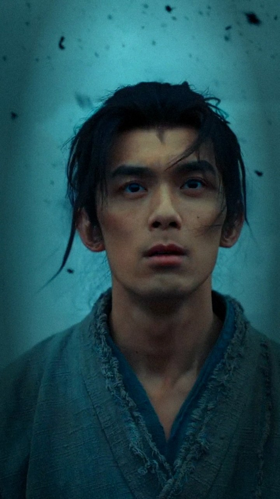

# 剑来 · 陈平安 · 60 秒加长版

> 同一个作品的第二条成片，提示词见 [prompt.md](../../prompt.md) 的后续交互第 2 条。规则和 [31.6 秒版](../../)一样：只用吴磊的单人镜头和他本人的台词，卡点、加特效；多出来的时间用来交代他从哪里来。

## 成片

| 预览 | 文件 | 时长 | 规格 | 大小 |
|---|---|---|---|---|
|  | [`jianlai_wulei-highlight_60s.mp4`](jianlai_wulei-highlight_60s.mp4)<br>原名：剑来_吴磊高光_9x16_60s.mp4 | 1:00.0 | 1080×1920 · 25 fps · H.264 CRF 20（上限 10 Mbps）· AAC 192 kbps · −14.1 LUFS / −1.6 dBTP | 73.3 MB |

逐帧预览：[成片](../../thumbs/jianlai_wulei-highlight_60s_sheet.jpg)

**一句话：** 短版只有「争一争」那段独白；加长版在它前面加了他的另一段独白「我原以为，眼前的这些人和事，就是这座小镇的全部。可这方天地，当真如我所见？」，配上小镇少年的安静镜头。中间接一段碎石冲击，再进锻造独白；高潮段配乐多用 7 秒，多一轮「慢放喘息 + 半拍快切」。性格从安静、发问，到刚毅、浴血，有了一个过程。

## 和 31.6 秒版的区别

| | [31.6 秒版](../../) | 60 秒版 |
|---|---|---|
| 结构 | 钩子 → 锻造独白 → 高潮 → 收尾 | 钩子 → **小镇独白** → **碎石冲击** → 锻造独白 → 高潮（**加长**）→ 收尾 |
| 他的台词 | 4 句 +「见自由」 | 9 句 +「见自由」 |
| 新用到的镜头 | — | 屋檐下仰脸、和狗蹲着笑、烧窑、雾中被掀飞前的正脸；火光侧脸、碎石、斗笠、举手都用得更长 |
| 高潮段 | 12.9 秒，11 个重拍 | 20.0 秒，17 个重拍 |
| 转场 | 全部硬切 | 安静段 0.3 秒叠化，其余硬切 |
| 码率上限 | 14 Mbps | 10 Mbps（时长翻倍，文件仍在 100 MB 以内） |
| 大小 | 54.5 MB | 73.3 MB |

## 剪辑清单

成片时间 → 原片时间。

| 成片 | 段落 | 画面（原片时间） | 声音（原片时间） |
|---|---|---|---|
| 0:00–0:01.3 | 钩子 | 四连快闪 0.33 秒一刀：火星爆发出拳（2:53）、浴血咬牙（2:55）、雾中被掀飞（2:15）、仰头咳血（2:17），闪白 + 切片错位 + RGB 错位 | 0:39.2 起的配乐 + 合成冲击、电流声 |
| 0:01.3–0:14.4 | 小镇独白 | 屋檐下仰脸（0:11）→ 火光侧脸（0:42）→ 和狗蹲着笑（2:42，原片只有 6 帧，0.2× 慢放）→ 烧窑（0:25.7，取景跟着他往左摇）→ 山道远眺（0:48）→ 斗笠仰望（0:49.7）→ 推近到眼睛（0:50.8）；除第一个镜头外都是 0.2–0.75× 慢放，0.3 秒叠化 | 0:39.2–0:53.6 原声，五句独白一刀不剪：「我原以为 / 眼前的这些人和事 / 就是这座小镇的全部 / 可这方天地 / 当真如我所见」 |
| 0:14.4–0:20.2 | 碎石冲击 | 碎石中背影（0:57.5）→ 碎石中正脸（1:00）→ 举起带血的手（1:07.8） | 0:57.4–1:03.2 原声，碎石镜头按原片的声画关系放，1:01.9 的重击上切到举手 |
| 0:20.2–0:30.2 | 锻造独白 | 同 31.6 秒版：低头流血（1:56）→ 汗湿抬眼 → 脱衣转身、火星四溅 → 锻打 → 肩背 → 举锤慢放 → 落锤火花 | 1:56.3–2:06.3 原声：「去路不由己 / 但我还是想 / 为自己 / 争一争」 |
| 0:30.2–0:43.1 | 高潮，一拍一刀 | 雨中「见自由」（2:27）→ 雾中正脸到被掀飞（2:15）→ 咳血（2:16.4）→ 泥地侧脸（2:21）→ 门缝（2:22.3）→ 斗笠、碎石正脸、火光、汗湿抬眼各一拍 → 赤背火星（2:01）→ 8 个四分之一拍快闪 → 举手推近（1:08） | 2:26.96 起原声，切点落在每 1.1775 秒的重拍上 |
| 0:43.1–0:50.2 | 喘息 + 半拍快切 | 山道远眺 0.5× 慢放（两拍）→ 8 个半拍镜头各 0.59 秒：火星、举锤、被掀飞、泥地、见自由、碎石、浴血、门缝 | 2:39.9–2:47.0 原声（原片这段是其他角色的出场卡，只借配乐；人声「出来」从 2:47.6 才开始） |
| 0:50.2–0:55.7 | 收尾 | 同 31.6 秒版：出拳慢放甩到脸（2:52.3）→ 浴血特写（2:53.8）→ 静默慢放、褪色、推近（2:56.4） | 2:51.84 起原声，含原片的那一拍静默 |
| 0:55.7–1:00.0 | 片尾 | 浴血特写定格压暗，「剑来」标题、「吴磊 饰 陈平安」「为自己 · 争一争」，比短版多停 1.1 秒 | 原片标题重击（2:57.3）+ 合成低频 |

## 关键制作步骤

1. **先找他还有哪些台词。** 把全片硬字幕按出现区间切出来拼成一张图，逐句读出时间；再对每句算基频和 MFCC 均值，和已确认是他的四句比。
   - 片头那段旁白（0:05–0:53，「开春了……当真如我所见」）是第一人称，画面也一直是他；用到的五句基频 95–115 Hz，和他那四句的音色距离 0.77–1.00（别人的台词在 1.06 以上），是他的独白。
   - 「此地的规矩」「本命瓷一旦烧成」「生死 尊严 去留」基频 180–230 Hz，是别人。
   - 只取其中连续的一截 0:40.8–0:53.4，五句之间不剪，配乐不断。起点 0:39.2 处前一句「望屋舍间的炊烟」已经结束，终点 0:53.55 在「见」字之后 0.3 秒的低谷里。
2. **逐帧核实每个镜头有多长。** 缩略图上看着是一个镜头的，实际可能很短：
   - 火光侧脸只有 1.6 秒（0:43.58 之后是月下两个人）。
   - 和狗蹲着那个镜头只有 6 帧（2:42.00–2:42.20）。
   - 慢放会多吃源片：第一版预览里狗那个镜头按 0.4× 放，跑进了下一位演员的出场卡。
   - 为此写了 [`check_shot_ranges.py`](../../scripts/check_shot_ranges.py)：按剪辑表把每个镜头实际显示的源帧解出来找切点，慢放、帧混合和叠化尾巴都算在内。帧先按亮度和反差归一化再比，火星、闪光不会误报。最后只剩浴血特写 2:56.0 一处，那是同一个镜头里的虚焦推近，不是切点。
3. **安静段的做法。**
   - 除第一个镜头外都是 0.2–0.75× 慢放，镜头之间 0.3 秒叠化。叠化要两个镜头同时解码，渲染器为此加了第二路解码。
   - 字幕换成逐字上浮淡入的小号宋体（96 px），九个字的「就是这座小镇的全部」也放得下。
   - 《剑来》角标只压在前三个镜头上：烧窑镜头他的脸在画面最上方，会撞上。
4. **碎石冲击段照搬原片的声画关系。** 原片 0:57.4 的起音就是碎石镜头的切点，背影和正脸按原片的同步关系用；1:01.9–1:02.4 的四下重击上切到举手，再落到锻造独白开头的环境声里，一下子静下来。
5. **高潮怎么加长。** 原片 2:39.9–2:47.0 是其他角色的出场卡，画面一个都不能用。但配乐还在同一个 101.9 BPM 的网格上：2:42.28、2:43.45、2:44.63、2:46.99 的强起音都落在重拍上。把这 7 秒接在高潮后面，换上他的镜头：先两拍的山道慢放，再 8 个半拍快切，最后在 2:46.97 的重拍上接回原来的收尾。
6. **码率。** 31.6 秒版平均 13.8 Mbps，基本贴着 14 Mbps 的上限，60 秒照样出会到 105 MB 左右。渲染脚本加了 `--maxrate`，这一版用 10 Mbps。
7. **验证。** 成片 1500 帧，正好 60.0 秒。每秒一帧共 60 张逐张看过，没有原片字幕、水印或其他角色；`check_shot_ranges.py` 只标出一处：浴血特写里的虚焦推近，同一个镜头，不是切点（短版也是这样）。高潮段 33.24、33.90、38.49 的切点上都有配乐起音，45.52 起的半拍切点对应原片 2:42.28 起的鼓点。响度 −14.1 LUFS、真峰值 −1.6 dBTP；安静段的短时响度比高潮低 3–5 LU，留出了起伏。

复现（在作品目录下运行，需要 [短版的渲染脚本](../../scripts/render_jianlai_wulei.py) 在同一个文件夹里）：

```bash
python scripts/render_jianlai_wulei_60s.py "吴磊《剑来》最新预告.mp4" 剑来_吴磊高光_9x16_60s.mp4 --scale 0.5 --fast   # 预览，约 2 分钟
python scripts/check_shot_ranges.py scripts/render_jianlai_wulei_60s.py "吴磊《剑来》最新预告.mp4"                  # 镜头不越界
python scripts/render_jianlai_wulei_60s.py "吴磊《剑来》最新预告.mp4" 剑来_吴磊高光_9x16_60s.mp4 --maxrate 10M      # 成片
```

## 复盘

**做得好**
- **加长不注水。** 多出来的 28 秒里，13 秒是他的另一段独白，7 秒是原片里没用上的那截配乐网格；屋檐、狗、烧窑这几个镜头短版都没用过。
- **两段独白一静一动。** 前一段在问「这方天地」是不是他看到的样子，后一段说「为自己争一争」；短版只有后者，加长版有了从发问到决断的过程，「刚毅果决」更有来由。
- **镜头越界有了自动检查。** 慢放、叠化让源片用量不再一眼看得出来，现在出片前跑一遍脚本就能确认没有别人的画面混进来。

**踩坑 / 注意**
- **镜头长度要逐帧量。** 出场卡类的快剪段一个镜头只有 6 帧；只看 1 fps 的缩略图会以为够用。
- **暗场里的切点帧差很小。** 火光侧脸切到月下两人，帧差只有 19.7，亮场切点一般在 50–100；固定阈值会漏，要按中位数自适应，或者先归一化再比。
- **素材就这么多，只能复用。** 山道、碎石、斗笠在 60 秒里各出现两次，靠不同的取景、速度和段落区分开。

**下次可以试**
- 用片头旁白里更早的几句（「我想要的很简单 / 饱食暖衣 / 友人相伴」）做一条更温和的版本，和这条比完播率。
- 安静段现在用的是原片那一截的配乐，起伏跟着原片的剪辑走；换成一整段连贯的配乐，叠化可以更从容。
