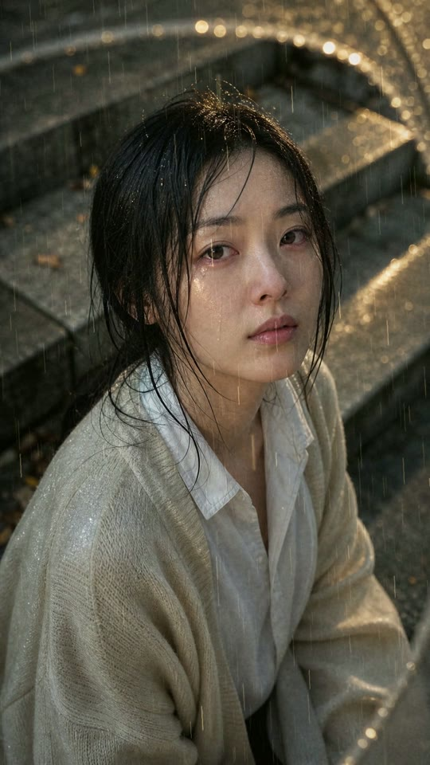
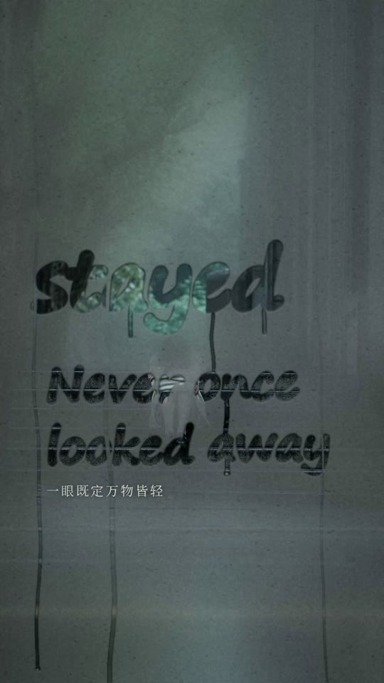

# 2026-11-10 · The Moment You Saw Me：同一场雨讲两遍

| 项 | 内容 |
|---|---|
| 日期 | 2026-11-10 |
| 类型 | 歌曲 MV，AI 生成写实画面（关键帧 + 景深视差运镜 + 程序化的雨和光），不是 AI 视频 |
| 工具 | gpt-image-2、whisper-1 / gpt-4o-transcribe（听写歌词）、Depth Anything V2 Small（本地）；Claude Code + ffmpeg、OpenCV、numpy/scipy、Pillow |
| 输入 | `TheMomentYouSawMe.m4a`（《今天是太阳雨》主题曲，3:03，第三方作品，**不入库**） |
| 产出 | 成片、歌词版，各带一条 40 MB 分享版。入库的是两条分享版；两条原画质版（各约 163 MB）留在本机 |
| 状态 | 2026-11-10 公开到仓库和[展示网站](https://anna-sap.github.io/Fun-Videos-Anna/#case-moment)。词曲是第三方作品，歌词文件注明「未经许可,不得翻唱或使用」，原曲音频和歌词文件不入库 |

## 成片

| 预览 | 文件 | 时长 | 规格 | 大小 |
|---|---|---|---|---|
|  | `media/the-moment-you-saw-me.mp4`（留在本机） | 3:03.0 | 1080×1920 · 24 fps · H.264 7.0 Mbps · 音轨为原曲 AAC 流原样复制 | 163 MB |

逐帧预览：[每 4 秒一帧](thumbs/the-moment-you-saw-me_sheet.jpg) · 一个镜头怎么来的：[关键帧、景深图、雨](thumbs/the-moment-you-saw-me_layers.jpg)

### 分享版

| 文件 | 时长 | 规格 | 大小 |
|---|---|---|---|
| [`variants/share/the-moment-you-saw-me_share.mp4`](variants/share/the-moment-you-saw-me_share.mp4) | 3:03.0 | 1080×1920 · 24 fps · H.264 1.6 Mbps · 音轨同样是原曲 AAC 流原样复制 | 39.6 MB |

从高质量的分镜文件直接两遍编码，不是把成片再压一次。先做了一道轻降噪（`hqdn3d=1.5:1.2:5:4`），把码率让给画面内容。代价：胶片颗粒基本没了，冷色镜头里最细的雨丝变淡，暖色镜头的雨和人脸细节保住了。与成片的 SSIM 为 0.949（亮度），音频包 MD5 一致，声画偏移 0.0 ms，23 个硬切位置不变。

### 歌词版

| 预览 | 文件 | 时长 | 规格 | 大小 |
|---|---|---|---|---|
|  | `variants/lyrics/the-moment-you-saw-me_lyrics.mp4`（留在本机） | 3:03.0 | 1080×1920 · 24 fps · H.264 7.0 Mbps · 原曲 AAC 流原样复制 | 162.7 MB |
| | [`variants/lyrics/the-moment-you-saw-me_lyrics_share.mp4`](variants/lyrics/the-moment-you-saw-me_lyrics_share.mp4) | 3:03.0 | 同上，1.6 Mbps，轻降噪 | 39.6 MB |

逐帧预览：[每 4 秒一帧](thumbs/the-moment-you-saw-me_lyrics_sheet.jpg) · [字的四种状态](thumbs/the-moment-you-saw-me_lyrics_states.jpg)

镜头前面多了一块起雾的玻璃，歌词是手指写在雾上的：只有笔画里面是清楚的，要看清她只能透过这些字。第一次副歌她用袖子把玻璃擦开，字反过来变成留在玻璃上的雾；第二遍同样的字自己浮回来，化成水痕把雾带走。镜头和剪辑点与成片相同，没有新生成图片，费用只有逐词对齐用的约 $0.03 转写。设计见 [lyrics-version.md](lyrics-version.md)。

歌词来自用户提供的 `TheMomentYouSawMe_lyrics.txt`（不入库），文件里带词曲署名和一行权利声明「未经许可,不得翻唱或使用」。署名放在了片尾。

**一句话：** 这首歌的后半首是前半首一个采样不差的重复，所以片子把同一个雨天讲了两遍：先是她藏着的，再是他看见的。副歌前伴奏停掉的 0.44 秒里，雨停在半空；下一拍，太阳出来，雨没有停。

歌曲分析和完整分镜见 [storyboard.md](storyboard.md)，提示词见 [prompt.md](prompt.md)。

## 素材与费用

生成素材都在 git 忽略的 `work/` 里。

| 素材 | 模型 | 次数 | 费用 |
|---|---|---|---|
| 歌词听写 | whisper-1、gpt-4o-transcribe、gpt-4o-mini-transcribe | 整首 2 次 + 分段 18 次 | 约 $0.10 |
| 角色参考像 | gpt-image-2 medium，1088×1920 | 1 | $0.04 |
| 关键帧 K01–K34 | 同上，其中 16 张带参考图 | 34 + 重做 4 | $1.78 |
| 景深图 | Depth Anything V2 Small，本地 CPU | 34 | 免费 |

图片费用是脚本按 token 用量记的账（`work/keyframes/usage.jsonl`），没有和账单核对；听写是估算。合计约 $1.9。

## 关键制作步骤

1. **先把歌量清楚。** 72.00 BPM、第一拍在 3.095 s，换到 24 fps 就是每拍 20 帧、每小节 80 帧。全曲响度起伏只有约 4 dB；唯一的事件是 55.97–56.41 s 伴奏整体停掉。第 29–52 小节和第 5–28 小节的波形相关 0.96，间隔正好 80.000 s。
2. **让结构决定叙事。** 既然音乐原样重复，画面就不重复：第二遍换成他的位置看同样的日子，两次副歌是同一个瞬间的两面。
3. **雨不画在图里。** 提示词里明确不要雨丝，雨由渲染器按三层景深的粒子画，挂在一条变速的钟上：预副歌三成速度，静默时为零并变成水珠，副歌第一拍恢复、换成金色。镜头运动也挂在这条钟上。
4. **人声旁边那一下刷擦声**（每小节第 2、4 拍）没有拿来卡剪辑，交给了伞面上的雨点和金色雨丝的微闪。
5. **硬切都在小节线上**（副歌里有三处落在第 3 拍，跟着句子走）；前奏、间奏、尾奏用叠化。
6. **音轨不动。** 原曲本身已经很响（−9.1 LUFS，真峰值 +1.8 dBFS），直接复制 AAC 流，不调音量、不重编码。
7. **校验。** 成片音频包的 MD5 与原文件一致；按容器时间戳解码后与分析用的波形互相关，四个时间点偏移都是 0.0 ms；场景检测找到的 23 个硬切全部落在节拍网格上。

## 复盘

**做得好**
- 结构上的发现（原样重复、0.44 秒静默）直接变成了叙事和高潮，不是事后往上贴的
- 纸杯这个道具：第一遍来路不明，第二遍有了主人，最后两只并排在窗台上
- s03 练好的笑和 s29 真的笑，都是只拍鼻梁以下，隔了两分钟呼应
- 第一遍始终不给她完整的脸，第二次副歌才正面看清，既是意思也省了人物一致性的麻烦

**踩坑 / 注意**
- ffmpeg 报原文件 `start: 0.0595`，那只是编码器的预留采样，容器已经跳过了。第一版成片照这个数减了 59.5 ms，声音早了 1.4 帧，互相关校验才发现
- 第一眼把响度看错了：`loudnorm` 摘要的最后几行是处理后的数值，原曲其实是 −9.1 LUFS，不需要加增益
- 第一版雨丝太稀太短，像虚线；改成更多、更细、亮度不一才像雨
- 静默那半秒起初落在俯拍水洼的镜头上，看不出雨停了。把水洼和她闭眼的特写对调，背景是暗的，水珠才看得见
- 人物有小出入：公交站那两镜她穿的是白裙，其余是深色裤子（可以当成不是同一天）；K31 里他的鞋是黑的，K33 里他的外套偏长
- Claude 听不到声音：节拍、段落、编曲的进出都是量的，歌词是模型听写的，音色和演唱的情绪只能从频谱推断。预副歌那句歌词没有定论，所以没上歌词字幕
- 人物不会动，所有动作都定格在一张图里
- 163 MB，颗粒和雨都很吃码率

**歌词版另外踩的坑**
- 第一稿的雾太透、字太小，笔画加了浮雕边，看起来像压印字而不是擦出来的。真实起雾的玻璃是雾发白发平、笔画里才有清晰和纵深，照这个改才对
- 浅色画面透过笔画和雾几乎一样亮，字就没了。给笔画加一圈被推开的水的暗边，雾在亮场景里压深一点
- 第二遍一开始让水痕一直留着，六句之后玻璃成了一道水帘，后面的歌词被切碎。改成每句唱的时候完整，离开时才流，几秒后水痕变淡
- 识别模型的逐词时间在句中很准，句首普遍偏早，要对着频谱图改
- 玻璃层让渲染慢了三倍多（约 55 分钟），主要是每帧几次大半径模糊
- 副歌里的"雾字"是风格化的处理，物理上并不严格；浅色衣服上对比偏弱

**下次可以试**
- 给三个镜头换真视频：s10（闭眼特写）、s11（逆光抬头）、s27（她抬起脸）
