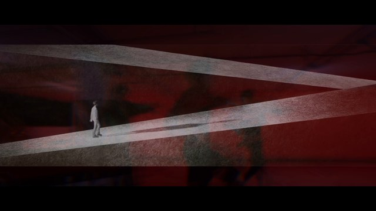

# 2026-11-13 · WinWin 混剪：重做转场

| 项 | 内容 |
|---|---|
| 日期 | 2026-11-13 |
| 类型 | 别人剪的混剪 → 只重做段落之间的衔接（画面 + 声音），不改镜头内容和顺序 |
| 工具 | Claude Code（云端）；numpy / scipy / OpenCV / librosa / Pillow；ffmpeg |
| 输入 | `winwin_V2_mixure_clip.mp4`（69.7 s，1920×1080，30 fps，70.2 MB），一段专人剪辑的混剪，三支 MV 首尾相接。第三方素材，**不入库**，经 Google Drive 分享链接取得 |
| 产出 | 成片 1 条（42.9 MB，经 Git LFS 入库） |
| 状态 | 2026-11-13 完成，PR 待合并 |

## 成片

| 预览 | 文件 | 时长 | 规格 | 大小 |
|---|---|---|---|---|
|  | `media/winwin-mix_smooth.mp4` | 1:09.3 | 1920×1080 · 30 fps · H.264 CRF 16（约 4.7 Mbps，BT.709）· AAC 256 kbps · −11.1 LUFS / −1.0 dBTP | 42.9 MB |

前后对照（上排原片，下排重剪）：[① 5.6 秒](thumbs/winwin-mix_t1.jpg) · [② 10.2 秒](thumbs/winwin-mix_t2.jpg) · [③ 30.0 秒](thumbs/winwin-mix_t3.jpg) · [开头与结尾](thumbs/winwin-mix_open-close.jpg) · 成片[每 2 秒一帧](thumbs/winwin-mix_sheet.jpg)

**一句话：** 把三支 MV 放进同一个黑色电影画框，让遮幅跟着音乐“呼吸”：开场像眼睛一样睁开，在第一首歌的落拍上撑满全画幅，进第二首时收成超宽银幕，进第三首时回到 2.35:1，片尾闭上。三个拼接点分别用动作（甩镜）、回声（残影）和空气（雾化成烟）接过去。

## 原片哪里生硬

逐帧统计画面、量每一段的速度、调性和响度后发现，原片其实是三支 MV 首尾相接，接口处画面和声音同时硬切：

| 拼接点 | 画面 | 声音 |
|---|---|---|
| ① 5.6 秒 | 白天白 T 恤镜头 → 2 帧机库闪切 → 红色停车场舞蹈；遮幅 2.35:1 突然变成满屏 16:9 | 同一首歌（约 103 BPM），一个强音后突然掉进安静处 |
| ② 10.2 秒 | 红色舞蹈 → 黑底白坡道；画幅突然变成约 3.06:1，上下边还是**白色**的 | 换歌：约 103 BPM、C 调 → 约 97.5 BPM、升 F 小调，两首歌的调性相差三全音，硬切 |
| ③ 30.0 秒 | 粉色亮雾 → 暗色烟雾的厅堂；画面平均亮度一帧内从 202 掉到 54，白边变黑边，右上角出现 SM 台标 | 换歌：→ 约 77 BPM、A 大调；响度掉 4.4 LU；接口处有一段 **20 ms 的数字静音** |
| 开头 / 结尾 | 第一帧就是满亮度画面；最后一帧停在 −23 dB 的音乐中间 | 没有淡入淡出 |

第三段 60–68 秒那几下闪白（天空、逆光、眼睛特写）也查过：音频里一条约 640 Hz 的长音垫贯穿不断，是同一首歌里的段落变化，属于 MV 自己的剪辑，没有动。

## 衔接设计

| 位置 | 画面 | 声音 |
|---|---|---|
| 开头 0–0.6 s | 遮幅从全黑“睁开”到 2.35:1，画面从 1.05 倍缓推到 1.0 | 60 ms 淡入；低通从 300 Hz 打开到 18 kHz，和遮幅同步 |
| ① 5.6 s | 6 帧横向**甩镜推入**：白 T 恤镜头带着运动模糊向左推出，停车场从右边推进来（停车场开头本身就是向右的甩镜，方向一致），中间两帧轻微提亮；去掉原来那 2 帧机库闪切和半成品的缩放。画框先保持 2.35:1，等到 6.17 秒音乐真正落拍时，遮幅在 6 帧内**撑满全画幅**，同时做一次 1.06 → 1.0 的冲击缩放 | 断点前最后一下强音做混响甩尾，填进后面的安静处；加一个很轻的、从右往左扫的风声，跟甩镜方向一致 |
| ② 10.2 s | **回声残影**：舞蹈最后 7 帧开始叠拖影、降饱和；接口之后，最后一帧舞者变成红色残影（RGB 错位），叠在第二段黑色的空间里，一边放大、模糊一边消散。白色坡道从 35% 亮度亮起，第二首歌第一个重拍（10.565 s）时完全亮起，残影也在这一拍最后闪一下。遮幅在这 17 帧里从满屏收成超宽的 3.06:1，白边一律改成黑边 | **回声收尾（echo-out）**：第一首歌的干声停在接口上，最后一个八分音符按 0.29 秒（103.4 BPM 的八分音符）乒乓回声 5 次，逐次变薄、变暗；第二首歌高通进来，**低音留到它的第一个重拍才回来**，正好落在第一首歌下一拍该落的位置 |
| ③ 30.0 s | **雾化成烟**：两段重叠 25 帧，按亮度溶解：第三段的暗部先从粉雾里浮出来，亮部最后才到。粉雾这一侧提前 1.8 秒慢慢变冷、变暗（“入夜”），烟雾这一侧开头带一层雾色、1.2 秒后散掉。镜头一直往里推：雾中 1.00 → 1.03，进烟以后继续推到 1.07。遮幅从 3.06:1 缓缓打开到 2.35:1；SM 台标随第三段一起淡入，保留原位 | 等功率交叉淡化 0.833 秒（第二、三首歌是关系大小调：升 F 小调 / A 大调）；重叠长度选 25 帧，是为了让第三首歌的起音正好落在第二首歌的八分音符上（偏差 < 20 ms）。第二首歌一边低通一边退出，留下一段 2 秒混响，像雾一样散开；原片那 20 ms 静音被交叉淡化盖住 |
| 结尾 | 最后 26 帧遮幅合拢成一条缝再闭上，画面同时推近 4%、最后 20 帧淡出；末尾留 0.4 秒黑场 | 1.45 秒淡出，低通从 18 kHz 合到 380 Hz |
| 响度 | — | 三段分别 −1.0 / −2.0 / +1.2 dB，从 −9.4 / −8.3 / −12.7 LUFS 拉到 −10.7 / −10.3 / −11.4 LUFS（第三首是安静的歌，有意留低 1 dB）；最后过一道 4 倍过采样的真峰值限幅 |

时间线：0–875 帧照原片；876–900 帧是第二段 876–900 帧与第三段 901–925 帧的溶解；之后第三段整体提前 25 帧，音频同样提前 0.833 秒，**每一段内部的音画关系都没有变**。成片比原片短 0.43 秒。

## 校验

| 项 | 原片 | 重剪 |
|---|---|---|
| 三个拼接点的最大逐帧像素跳变 | 70 / 108 / 148 | 34 / 26 / 9 |
| 三段响度差 | 4.4 LU | 1.1 LU |
| 真峰值 | 0 dBFS（削顶） | −1.0 dBTP |
| 没动过的画面 SSIM（舞蹈段 / 第三段各一段） | — | 0.996 / 0.997 |
| 音画同步（互相关） | — | 前两段偏移 −4 ms（AAC 编码延迟，全片一致）；第三段 0.8294 s + 4 ms = 0.833 s，正好 25 帧 |

成片 2078 帧，视频 69.267 s，音频 69.266 s。

## 关键制作步骤

1. **先找接口。** 逐帧算颜色直方图距离和像素差（[`framestats.py`](scripts/framestats.py)），量每一帧上下黑边的位置（[`bars.py`](scripts/bars.py)），再看接口前后逐帧拼图。黑边一共四种：2.35:1 黑边、满屏、约 3.06:1 白边、2.35:1 黑边带台标。
2. **再听接口。** 频谱新奇度峰值、分段起音自相关求速度、色度图求调性（[`audio_ana.py`](scripts/audio_ana.py)、[`audio2.py`](scripts/audio2.py)），起音包络和波形叠在一张图上看拍点（[`plot_cuts.py`](scripts/plot_cuts.py)）。结论：三首不同的歌，第二、三首是关系大小调，第一、二首调性相差三全音。
3. **按接口的性质选手法。** 同一首歌里换画面，用动作接（甩镜）；调性冲突的两首歌，用回声收尾、低音交接，不让两首歌的和声同时响；调性相容又都是“雾”的两段，用长溶解。所有转场都卡在音乐上：撑开画框在落拍，残影消散在第二首歌第一个重拍，溶解长度让两首歌的起音对齐。
4. **一个渲染器逐帧合成**（[`render.py`](scripts/render.py)）。从 ffmpeg 读 RGB（显式 BT.709），numpy / OpenCV 逐帧做遮幅、甩镜、残影、按亮度溶解、推镜，再按 BT.709 写回 x264。时间线和关键帧号统一放在 [`timeline.py`](scripts/timeline.py)。
5. **音频单独混**（[`audio_mix.py`](scripts/audio_mix.py)）。时变滤波（逐块更新系数的 Butterworth）、合成混响（噪声 × 指数衰减）、乒乓回声、等功率交叉淡化，最后用 [`tp_limit.py`](scripts/tp_limit.py) 做真峰值限幅。
6. **量出来再交付。** 逐帧跳变对比、分段响度、SSIM、音频互相关查同步，再看前后对照拼图（[`compare_sheets.py`](scripts/compare_sheets.py)）。

复现：

```bash
ffmpeg -i winwin_V2_mixure_clip.mp4 -vn -ac 2 -ar 44100 audio.wav
python3 scripts/audio_mix.py audio.wav mix_raw.wav
python3 scripts/tp_limit.py mix_raw.wav mix_final.wav -1.6
python3 scripts/render.py winwin_V2_mixure_clip.mp4 mix_final.wav out.mp4   # 约 2 分钟（4 核）
```

渲染器不再处理音频电平，只把 `mix_final.wav` 编码成 AAC 256 kbps 放进成片。

## 复盘

**做得好**
- 先判断“是什么让它生硬”，再动手：画面跳变、画幅跳变（含白边）、调性冲突、响度落差、20 ms 静音，每一项都有对应的处理，而不是在每个接口套同一个溶解
- 同一套设计语言贯穿全片：一个会呼吸的黑色画框，开场和结尾首尾呼应；三个转场分别用动作、回声、空气，每个都和那一处的画面内容有关（停车场开头本来就在甩镜；第二段第一个镜头是黑色空间；第三段一开场就是烟）
- 声音和画面是一件事：遮幅打开时低通也在打开，残影消散时回声也在消散，雾化成烟时第二首歌留下的是一段混响
- 每一段内部的音画关系一帧没动，第三段整体提前 25 帧，用互相关核过
- 第三段的 SM 台标原样保留，随第三段一起淡入淡出

**踩坑 / 注意**
- `-ss` 放在 `-i` 前面对这个文件定位不准，第一次抽的“接口帧”其实是别处的画面；改用 `select` 按帧号取帧
- 溶解时画框从 228 px 打开到 129 px，第二段被涂黑的白边区域会露出来，形成一条暗带；把第二段的雾镜像延伸进边框区域、再柔化，才干净
- 第二首歌一开始高通压得太狠（950 Hz），接口后 0.3 秒电平掉到 −25 dB，像漏了一拍；改成 480 Hz 起、回声第一次重复更响，回到 −17～−23 dB，保留一点“呼吸”让低音落拍更有分量
- ffmpeg 的 `alimiter` 把上限设得更低，AAC 编码后的真峰值反而从 −0.4 升到 +1.2 dBFS；改成自己写的 4 倍过采样前瞻限幅，最终 −1.0 dBTP
- 原片每 4 秒有一帧黑边里的蓝色抬升（编码问题），画面里看不出来；重剪的黑边是纯黑，顺带消掉了

**没把握的地方**
- 制作者听不到声音。回声、风声、混响的电平都按测量定的，实际听感请以耳朵为准；风声比音乐低 16 dB 以上，如果觉得多余，把 `audio_mix.py` 里 whoosh 那一行的 `db(-27)` 调低或删掉重混即可
- 三支 MV 的具体出处没有逐一核实，只从画面判断第三段是 SM Entertainment 的视频

**下次可以试**
- 出一版“统一 2.35:1”的对照：全片固定一个画幅，看和“会呼吸的画框”哪个更顺
- 把遮幅动画、甩镜、残影、按亮度溶解抽成通用的转场模块，给以后的混剪用
