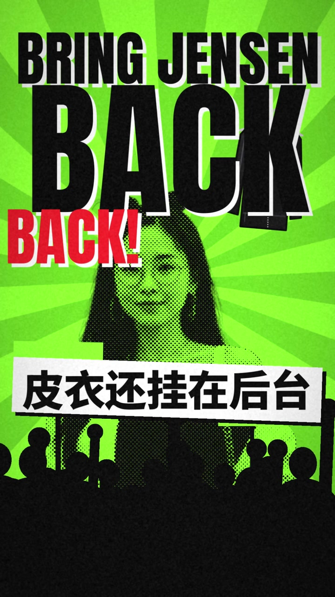

# 2026-11-14 · Bring Jensen Back：一首嘻哈的"先要证据"

| 项 | 内容 |
|---|---|
| 日期 | 2026-11-14 |
| 类型 | 嘻哈 MV（歌词逐字同步），主角是附图里的女孩；画面全部由程序逐帧渲染，只用了这一张抠像，没有调用任何图片或视频生成模型 |
| 工具 | Claude Code（云端）；numpy / OpenCV / Pillow；Demucs htdemucs（人声分离）、faster-whisper large-v3 和 large-v3-turbo（识别、强制对齐），都在本机 CPU；Playwright Chromium（把手写的 SVG 道具渲成 PNG）；ffmpeg |
| 输入 | `bring_jensen_back - v2.mp3`（275.23 s，Suno 生成）、`bring_jensen_back - claude.txt`（歌词）、一张抠好背景的女孩全身照。三者都是用户提供，**不入库** |
| 产出 | 成片 1 条（178.8 MB）+ 分享版 1 条（68.3 MB），经 Git LFS 入库 |
| 状态 | 2026-11-14 完成，PR 待合并。歌里涉及真实人物和正在发生的新闻，公开发布前请看文末"内容与权利" |

## 成片

| 预览 | 文件 | 时长 | 规格 | 大小 |
|---|---|---|---|---|
|  | `media/bring-jensen-back.mp4` | 4:35.2 | 1080×1920 · 24 fps · H.264 两遍 5.0 Mbps（BT.709）· 音轨为原曲 MP3 流原样复制 | 178.8 MB |
| | `variants/share/bring-jensen-back_share.mp4`（分享版，网站用） | 4:35.2 | 同上，1.8 Mbps，编码前轻降噪 | 68.3 MB |

逐帧预览：[每 4 秒一帧](thumbs/bring-jensen-back_sheet.jpg) · [关键时刻逐帧](thumbs/bring-jensen-back_events.jpg) · 歌词校对：[逐字时间画在人声频谱图上](thumbs/bring-jensen-back_timing.jpg)

校验：两个版本的音频包 MD5 都与原曲一致（`7bb1aa46…`），30 / 100 / 180 / 250 s 四点互相关偏移都是 0.00 ms；6606 帧，视频 275.250 s、音频 275.208 s（差 42 ms，约一帧）。场景检测找到 113 个硬切：44 个在拍点 2 帧以内，另外 69 个在某个字的演唱起点或人声切片起音 3 帧以内（副歌弱起、呼应、切片本来就按演唱切），没有落在两者之外的。

**一句话：** 这首歌一半是新闻标题、一半是口号，两样都是印出来的东西，所以每个字在被唱出来的那一帧像橡皮章一样盖到画面上；主角是领喊的 MC，跟着实测的鼓点点头；歌里那个人从不露脸，只以一件挂在后台的皮衣、一把空椅子和一盏一直亮着的绿灯出现。

歌曲分析、规则和完整镜头表见 [storyboard.md](storyboard.md)，提示词见 [prompt.md](prompt.md)。

## 关键制作步骤

1. **量歌。** 96.00 BPM、第一个强拍 0.090 s，24 fps 下一拍正好 15 帧。从分离出的伴奏里逐 16 分音符找底鼓和军鼓，得到整首的鼓型表：前 12 小节没有鼓，第 13 小节鼓进来，**第 29 小节伴奏全停**（"Thirty-three years… one week?"），第 58 小节是 Drop。这三个点决定了片子的三个最大的切。
2. **确认唱的是什么。** MP3 里嵌的歌词段落顺序和 txt 不一样；整首识别证实实际顺序和 txt 一致，并找出 txt 和演唱的四处出入（见 storyboard）。
3. **逐字对时间。** 中文按字、英文按词，97 个演唱条目、1116 个单位。两个模型 × 人声和混音 × 三种窗口切法，**每个字 12 个独立估计取中位数**；离散大的 7 处对着人声频谱图手工改（其中"一九九三"那一句对齐早了 1.7 秒，是通看全片时发现的）。Drop 后半的人声切片对不出词，就只按 17 个实测起音切画面，不印字。
4. **主角。** 一张抠像做出七种"印法"：彩色贴纸、绿色网点、报纸油墨网点、复印机黑白、霓虹线描、宝丽来、波普网格。脖子以上在每个实测的底鼓和军鼓上做一次小角度形变（点头），身体在底鼓上下沉。
5. **道具和场景。** 19 个道具手写成 SVG（皮衣衣架、空椅子、咖啡杯、纸船、芯片、门、天平、仪表……），用 Chromium 渲成透明 PNG；7 种场景（餐厅卡座、LED 点阵舞台、集会、报纸、全黑、案卷板、信纸）由 numpy/OpenCV 每帧计算。
6. **字。** 一句按短语拆成几行，每行缩放到同样的宽度（嘻哈海报的两端对齐堆叠），行距按字形的真实上下边界算。每段一种字体和一种命运：舞台的白绿大字、报纸衬线体、打字机等宽字、手写体；会被划掉、涂黑、受重力掉落、跟着倒带按倒序消失。
7. **渲染和合成。** 每帧是时间的纯函数，按 96 帧一段 4 进程并行渲染（首次整片渲染约 18 分钟；之后按段重渲了三轮共 23 段），再两遍编码，原曲音频流原样复制。

## 脚本

从作品目录运行（`python3 scripts/…`），中间产物都在 `work/`（不入库）。歌词文字只在运行时从用户的歌词文件读，脚本和 JSON 里只有行号、单位序号和时间。

| 脚本 | 做什么 |
|---|---|
| `analyze_audio.py`、`analyze_structure.py` | 响度、速度候选；拍点网格和逐小节表（本次加了 `BPM_LO/BPM_HI` 环境变量） |
| `drums.py` | 从分离出的伴奏逐帧量底鼓、军鼓、踩镲的起音和包络，打印每小节的 16 分音符鼓型表 |
| `asr_local.py`、`asr_chunks.py` | 本机 faster-whisper 识别（整首 / 切成短块防止循环幻听） |
| `lyrics.py`、`sung.py` | 把歌词表拆成"中文按字、英文按词"的单位；实际演唱的条目和大致时间窗 |
| `align.py`、`timing.py` | 强制对齐取中位数；插值、频谱图修正（`SEEN`）、保序 |
| `spec_marks.py`、`vocal_spectrogram.py` | 人声频谱图，画上每个单位的起点（只标编号） |
| `fetch_fonts.py`、`props_svg.py`、`render_svg.mjs` | 按片中用字取字体子集；手写 SVG 道具并用 Chromium 渲成 PNG |
| `common.py`、`girl.py`、`scenes.py`、`typo.py`、`fxlib.py` | 画布和网格常量；主角的摆放、点头和七种印法；七种场景；盖章式歌词排版；道具、计数器、K 线、印章、倒带等 |
| `timeline.py` | 整首歌的镜头表和逐句设计 |
| `render.py`、`grab.py` | 逐帧渲染（96 帧一段、多进程、断点续跑、`--preview`）；从段文件取单帧 |
| `finish.py`、`qc_audio.py`、`qc_cuts_vocal.py` | 拼接并原样复制原曲音频；音频 MD5 + 互相关校验；硬切落在拍点还是演唱起点 |

## 素材与费用

| 素材 | 来源 | 费用 |
|---|---|---|
| 画面 | 本机程序逐帧渲染，6606 帧 | 免费 |
| 主角 | 用户提供的抠像（1083×755） | — |
| 人声分离 | Demucs htdemucs，本机 CPU | 免费 |
| 识别、强制对齐 | faster-whisper large-v3、large-v3-turbo，本机 CPU | 免费 |
| 字体 | Noto Sans SC、Noto Serif SC、智芒行（Zhi Mang Xing）、Anton、Archivo Black、Space Mono、Permanent Marker（均为 OFL / Apache，经 Google Fonts，按片中用字取子集） | 免费 |

## 复盘

**做得好**
- 三个最大的切都来自量出来的鼓型：鼓进来（第 13 小节）、全停（第 29 小节）、Drop（第 58 小节）。全停那一小节是全片唯一没有颗粒和冲击的画面。
- 没有出图通道，只有一张抠像，也撑满了 4 分半：动作交给实测鼓点，变化交给"印法"和场景。
- 涉及真人的部分克制处理：不画任何真人的脸，不仿任何媒体的报头或公司标志；歌里那个人只以皮衣、空椅子和绿灯出现。
- 逐字时间每个字 12 个估计，离散大的地方看频谱，不确定的切片段不硬印字。

**踩坑 / 注意**
- 行距按字号算会让大号英文压住上一行；改成按每行字形的真实上下边界堆叠。
- 第一版副歌的口号和 (Back!) 回应章正好压在主角脸上，黑底副歌又用了反相网点（脸成了一团绿点），挑海报帧时才发现：人物下移到口号下面、回应章挪到脸旁边、统一成"绿底黑点"的正向网点，重渲了副歌的 12 段。挑海报帧本身就是一次检查。
- 一个演唱条目拆成两层字（副歌的口号和中文答句）时，"下一句来就下场"要按条目算，不能按字层算，否则口号在答句一开唱就消失了。
- 只给有字层的条目算下场时间，会让上一句在没有字层的条目（Drop 的切片、READY? 3 2 1）里一直挂着；下场时间要按全部演唱条目算。
- 中间文件第一次用 x264 `medium` 预设，编码器和渲染进程抢 CPU，每分钟只出 1.5 段；换成 `veryfast`（CRF 13）后断点续跑。
- OpenCV 5 的 `putText` 只收 8 位图；`np.empty() * 0` 在未初始化的内存上会得到 NaN，填色要用 `np.full`。
- Google Fonts 的 `text=` 子集分块请求后合并，需要先删掉各块的 GSUB/GPOS，否则 fontTools 合并报错；`·` 不在汉字区间里，第一次漏取了。

**没把握的地方**
- 制作者听不到声音。逐字时间来自识别加人工修正，看的时候请留意哪句的字和演唱对不上：最可能出问题的是前奏的 "Bring him / Back" 呼应（起点是对着频谱估的）、Drop 里的 "Stand with" 三连、和结尾 "Then bring Jensen… back"。
- Drop 后半（152–158 s）和结尾 262–273 s 的人声切片识别不出词，画面只跟着起音切，没有印字。
- 主角只有一张静态照片，所有动作都是形变和镜头运动，不是真的动作。头部点头是小角度形变，长发和耳环跟着弯，近看能看出来。
- 片尾署名用的是 MP3 元数据里的 `annasu82 / Suno`。

## 内容与权利

- 歌曲由用户用 Suno 生成，歌词文件和音频不入库；成片的音轨是原曲 MP3 流原样复制。
- 歌词涉及真实人物（黄仁勋）和一组发生在 2026 年 10–11 月的新闻事件。制作者的知识截止早于这些事件，**没有核实歌词里的任何事实**；画面只是把歌词排出来，日期章、K 线、-11% 都是按歌词画的示意，不是数据。
- 片中不出现真人肖像、真实媒体的报头或公司标志（"logo"一句画成一块空白的绿色灯牌）。
- 公开发布前请自行判断：歌里对真实人物的私人生活有具体陈述。
