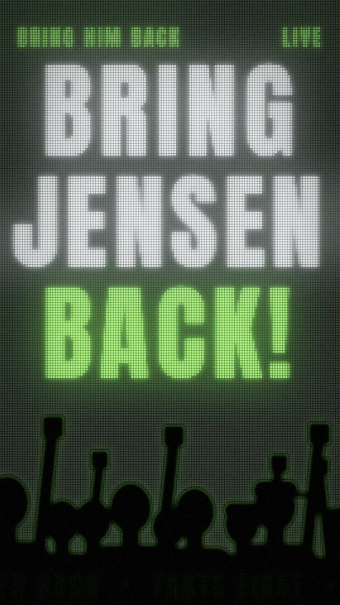

# 2026-11-14 · Bring Jensen Back · LED 墙：一面不肯熄灭的灯墙

| 项 | 内容 |
|---|---|
| 日期 | 2026-11-14 |
| 类型 | 嘻哈歌词 MV，画面全部由程序计算（一面 135 × 240 颗灯的 LED 点阵墙 + 人群剪影），没有用图片或视频生成模型 |
| 工具 | Claude Code；numpy / scipy / OpenCV / Pillow；faster-whisper（large-v3、large-v2、medium、small）、sherpa-onnx（SenseVoice、Paraformer）、UVR Kim_Vocal_2（人声分离），均为本机 CPU；ffmpeg |
| 输入 | Suno 生成的 `bring_jensen_back_girl-intro.mp3`（5:14.78，与 [同日另一支](../2026-11-14-01-bring-jensen-back/) 的 v2 是同一首歌的不同生成版本），用户提供，**不入库** |
| 产出 | 成片 1 条 + 分享版 1 条（均经 Git LFS 入库） |
| 状态 | 2026-11-14 完成，成片已按作者要求入库。第二段主歌有 3 处存疑待作者核对 |

## 成片

| 预览 | 文件 | 时长 | 规格 | 大小 |
|---|---|---|---|---|
|  | [`media/bring-jensen-back-led-wall.mp4`](media/bring-jensen-back-led-wall.mp4)（母版） | 5:14.8 | 1080×1920 · 30 fps · H.264 6.0 Mbps 两遍（BT.709）· 音轨为原曲 MP3 流原样复制 | 243.4 MB |
| | [`variants/share/bring-jensen-back-led-wall_share.mp4`](variants/share/bring-jensen-back-led-wall_share.mp4)（分享版） | 5:14.8 | 同上，2.5 Mbps，编码前轻降噪 | 105.8 MB |

成片按作者要求经 Git LFS 入库（云端直接推送）。歌词点名一位真实人物并写到具体事件，属于作者本人的创作；SHA-256：母版 `3ff671d0…6f3a`，分享版 `21f54829…6588`。

逐帧预览：[每 4 秒一帧](thumbs/bring-jensen-back-led-wall_sheet.jpg) · 时间对齐校验：[逐字起点画在人声频谱图上](thumbs/bring-jensen-back-led-wall_timing.jpg)（标签是"句号.字号"，不含歌词）。

校验：两条成片的音频包 MD5 都与原曲一致（`a8cc7b3a…0243`），30 / 100 / 200 / 290 s 互相关偏移 0.00 ms；9443 帧，视频 314.767 s、音频 314.760 s（相差 7 ms，不到一帧）；鼓进来的 20.222 s 之后第一帧即闪白，前副歌的字在整句唱完后才落下，第 51 小节墙随低音变暗，312.6 s 熄灯后只剩绿灯和字影，均逐帧确认。

**一句话：** 歌里反复出现"green light on / 绿灯亮着 没人关"，所以整支片子只有一面 LED 墙，歌词是墙上被唱亮的灯：每个字在被唱出的那一刻点亮，琥珀色是 1993 年的卡座，绿是那盏没人关的灯，红是头条，白是事实。副歌的 BRING / JENSEN / BACK! 亮得够久就烧进了墙里，之后每一段都隐约可见；片尾所有灯熄灭，只剩一盏绿灯和那行字影。

歌曲分析和分段设计见 [storyboard.md](storyboard.md)，提示词和过程见 [prompt.md](prompt.md)。

## 歌词从哪来

- 对话分享链接有 Cloudflare 人机验证，云端读不到。MP3 的 `lyrics-eng` 标签里有 Suno 生成时的整份歌词，以它为底本。
- 实际演唱和这份歌词有出入：**第二段主歌（93.6–141.3 s）是一段新写的新闻时间线**，第二次副歌唱成了倒数加口号，Bridge 之后用口号代替了第三次前副歌，第一段主歌末的副歌句只唱一遍。第二段主歌的文字由四个模型分段听写、候选打分得到，仍有 3 处只能在"音最像"和"意思通"之间取舍（第 6、9、12 句），交付时已列给用户核对。
- 逐字时间：先给每句一个粗区间（转写 + 节拍网格），再用 large-v2（人声轨和原混音）、medium、small 对 3 句一组的重叠窗口做强制对齐，每个字取中位数，最后把字头吸附到人声轨上最近的起音峰（−90 / +60 ms 内）。口号段（前奏的一呼一应、第二次副歌、结尾）按人声起音峰逐词定时。
- 歌词文本只存在于 `work/`（不入库）；脚本按段落和句序引用歌词。

## 关键制作步骤

1. **量歌。** 94.99 BPM（一拍 0.6316 s），底鼓在 1、3 拍；前 8 小节没有鼓；第 29 小节和第 51 小节低音整体抽空；第 82–88 小节半速；第 112–119 小节抽空且第 113 小节人声静默。每一项都对应到画面上的一个决定，见 storyboard 第 1 节。
2. **还原实际唱词。** 见上一节。
3. **定规则。** 字是灯：点亮时过亮一下（灯丝预热），关掉后有余辉；主歌旧句上推变暗；前副歌里字从墙上一列列摔下去；"run it back"时墙上的内容倒放；副歌三行大字烧屏。
4. **写渲染器。** 每帧先在 135 × 240 的灯泡网格上算亮度，再展开成圆点、加辉光；墙的电源跟底鼓包络呼吸，抽空的小节改由低音能量供电；人群剪影在副歌和口号处随底鼓起伏，在"(Back!)"上举拳。
5. **音轨不动。** 原曲 MP3 流原样复制进 mp4。

## 素材与费用

| 素材 | 来源 | 费用 |
|---|---|---|
| 画面 | 本机程序计算，9443 帧（30 fps） | 免费，按 10 秒分 32 段、4 进程并行渲染约 32 分钟，两遍编码母版约 22 分钟 |
| 识别、打分、强制对齐 | faster-whisper 4 个模型 + sherpa-onnx 2 个模型，本机 CPU | 免费 |
| 人声分离 | UVR Kim_Vocal_2 ONNX，本机 CPU | 免费 |
| 字体 | Noto Sans SC Black、Anton（均为 OFL，经 Google Fonts，只取用到的字） | 免费 |

## 复盘

**做得好**
- 拿不到分享链接时，先查了文件本身：Suno 的 MP3 把整份歌词存在 ID3 标签里。
- 转写一发现和歌词对不上就换成"实际演唱优先"，并用强制解码打分代替自由转写来裁决分歧。
- 规则只有一条（字是灯），所有段落的变化都是这条规则的变体：颜色、余辉、坠落、倒放、烧屏。

**踩坑 / 注意**
- Whisper large-v3 在纯人声轨上大段幻觉（"字幕志愿者"等）；large-v2 和 Paraformer 在这首歌上更可靠。
- 强制解码打分偏爱"语言模型觉得通顺"或"音节更少"的候选，需要结合语义和时间线判断，不能只看分数。
- 全局序列匹配在重复段落（多次副歌、两遍尾段）上会串位，粗区间需要按段落人工给出。
- 字体子集按内嵌歌词下载，漏了第二段主歌里的新字；改成按实际演唱版重新取字。

**下次可以试**
- 让用户直接附上最终版歌词的 txt。
- 口号段也做强制对齐，而不只是起音峰定时。
