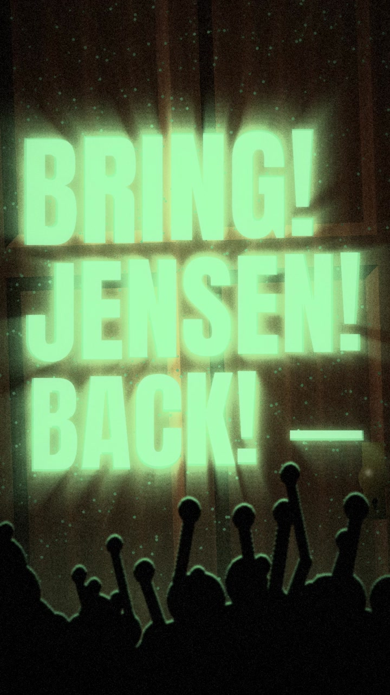

# 2026-11-17 · Bring Jensen Back 2.0：门没开，灯没关

| 项 | 内容 |
|---|---|
| 日期 | 2026-11-17 |
| 类型 | 创意歌词 MV（逐字同步的动态排版），画面全部由程序逐帧计算，没有用图片或视频生成模型 |
| 工具 | Claude Code（云端）；numpy / scipy / OpenCV / Pillow；UVR Kim_Vocal_2（人声分离，ONNX）、faster-whisper large-v2 和 medium（转写、强制对齐），均为本机 CPU；ffmpeg |
| 输入 | `bring_jensen_back_2.0_chinese-melody2.mp3`（303.24 s，Suno 生成，作者 annasu82）和写在提示词里的歌词。都不入库 |
| 产出 | 成片 + 分享版（Git LFS） |
| 状态 | 2026-11-17 完成。歌里涉及真实人物和正在发生的新闻，公开发布前请看文末"内容与权利" |

## 成片

| 预览 | 文件 | 时长 | 规格 | 大小 |
|---|---|---|---|---|
|  | `media/bring-jensen-back-week-two.mp4`（母版） | 5:03.2 | 1080×1920 · 30 fps · H.264 两遍 5500 kbps（BT.709）· 音轨为原曲 MP3 流原样复制 | 215.6 MB |
| | `variants/share/bring-jensen-back-week-two_share.mp4`（分享版） | 5:03.2 | 同上，2000 kbps，编码前轻降噪 | 82.9 MB |

逐帧预览：[每 4 秒一帧](thumbs/bring-jensen-back-week-two_sheet.jpg) · [规则怎么变：每段一扇门](thumbs/bring-jensen-back-week-two_doors.jpg) · [关键时刻逐帧](thumbs/bring-jensen-back-week-two_events.jpg) · 歌词校对：[每个字的出现时间画在人声频谱图上](thumbs/bring-jensen-back-week-two_timing.jpg)（红线是每句第一个字，标签只有句子编号）

校验：两条成片的音频包 MD5 都与原曲一致（`44aa5c71…b9`），30 / 100 / 200 / 290 s 四点互相关偏移都是 0.00 ms；9097 帧，视频 303.233 s、音频 303.216 s（差 17 ms，不到一帧）。屏幕文字与歌词逐字核对：100 个演唱条目、1928 个字形，和歌词原文（去掉编曲提示后）逐字符一致，没有遗漏的歌词行。11 个段落切换里 5 个落在实测强拍上，另外 6 个是抢拍进来的句子，切在这一句第一个字前 0.08 s；段落内的换句是 0.32 s 的甩镜，不是硬切

**一句话：** 歌名就是规则——门没开，灯没关。整支片子是一扇关着的门，门后的灯一直亮着；每个被唱出来的字都是门上被敲穿的一个洞，光从字里透出来，最新唱出的那个字最亮，视线自然跟着它走。每一段换一扇门（正门、战情室钢门、华盛顿的白色双开门、董事会胡桃木门、国会软包门），只有"鼓全停"的间奏离开门，去看海那边那面亮了灯的"整面墙"。门缝下那条光从第一帧亮到最后一帧。

歌曲分析、规则和分段镜头表见 [storyboard.md](storyboard.md)，提示词和过程见 [prompt.md](prompt.md)。

## 这首歌量出来是什么样，以及它变成了画面里的什么

| 量出来的 | 画面 |
|---|---|
| 前 8 小节没有鼓，只有底噪和新闻采样；人声轨 4.6 s 才有声音 | 黑暗里一扇门，门缝下电视的蓝光在闪；新闻采样用等宽字像电视光一样闪着出现；"Week two." 被 scratch 的那一下画面跳帧，门后的灯从电视蓝变成绿色 |
| 第 9 小节鼓进；主歌一每个底鼓都在 | 每个底鼓在门上扎一把针孔：主歌结束时门上已经是一片星点（"十八万"）。副歌和 Drop 回到同一扇门时，这些针孔都还在 |
| 前副歌鼓抽掉，只剩 808 和 riser | 战情室钢门；字像日光灯管一样闪着亮起，亮度跟着 808 的包络一明一暗；光束随 riser 越拉越长，最后白闪进副歌 |
| 副歌底鼓密度全曲最高 | 主句像拳头砸门（slam），门随底鼓和军鼓震；前景是被门缝光逆光勾边、随底鼓举拳的人群剪影 |
| 后半首速度从 86.8 漂到 84 BPM | 推镜和震动对的是逐拍跟踪出来的实测拍点和鼓的起音，不是固定网格 |
| 间奏鼓全停、宽 pad | 全片唯一不是门的场景：海那边的塔，整面外墙渐渐亮成灯，两句引语用 LED 点阵亮在塔身上 |
| Bridge 半速，钢琴 + pad | 国会的软包门，琥珀色，字从下往上慢慢升起；"没写完的报告"一句有打字光标在闪；"一步一步走完"按台阶斜着往上排 |
| 结尾 287–297 s 只有钢琴，最后一句唱两遍 | 第一遍在门上淡出；钢琴段镜头慢慢拉远到整扇门；第二遍是远景，字淡出后只剩门缝下的光 |

## 字怎么跟着歌走

- **逐字一致。** 每一行屏幕文字都直接从歌词原文切出来（引号、破折号、问号、全角感叹号、括号原样保留），脚本里只记字符位置；每个字符归属一个唱出的单位（汉字或英文词），在那个单位被唱出的那一帧被"敲"穿。
- **每个字的时间。** 先把人声分离出来，在人声轨上分窗转写确定每句的实际起止；再用 large-v2 和 medium × 人声轨和原混音 × 三种窗口切法强制对齐，**每个字 12 个独立估计取中位数**（大多数句子的离散在 0.1 s 以内）；离散大的地方对着人声频谱图手改了 17 处，Drop 里重复的一句按实测音节起音逐个分配。
- **字的命运随歌词变。** "缺口""炸了群"两句碎裂离场；"黑名单"被一道黑条涂掉；"后门被堵完"时那两个字的光一个个熄灭；"十天的期限 才过了两天"时门楣上十盏灯左边两盏熄灭，尾声"还剩八天"时第三盏在闪；"烟消云散"往上飘散，"对半""失眠"往下掉；"run it back" 出现时画面倒带闪烁；市场下跌那几句，一道"K 线"从董事会的门板上裂开，光从裂缝里漏出来。
- **镜头。** 每句开始前 0.3 秒镜头甩到这一句在门上的位置，句子停留时慢慢推近；段落切换落在实测的强拍上。

## 关键制作步骤

1. **量歌。** 速度、强拍、逐小节鼓型、响度（`analyze_structure.py`、`grid_fit.py`、`beats.py`、`drums.py`）。发现后半首速度漂移，改用逐拍跟踪。
2. **确认实际唱法。** MP3 内嵌歌词字段顺序错乱，弃用；转写证实演唱顺序与提示词一致，并找出：括号呼应都唱了、"run it back" 在前奏里唱两遍（画成残影）、Drop 第一句唱两遍、Build 里三个说话人标签没唱（照样上屏，作为标签随句首出现）、结尾一句唱两遍。
3. **逐字对齐。** 见上一节。
4. **规则和画面。** 五扇门是程序生成的贴图（木纹、钢板、线脚、软包、铜牌、门缝）；字是遮罩，洞里是光，洞的一侧露出门板的厚度，洞外的门板被漏出的光照亮，空气里有朝镜头散开的光束（四分之一分辨率的径向模糊）。
5. **渲染和合成。** 每帧是时间的纯函数；每段 300 帧、4 进程并行渲染约 29 分钟（每帧约 0.7 s），再两遍编码，原曲音频流原样复制。

## 脚本

从作品目录运行（`python3 scripts/…`），中间产物都在 `work/`（不入库）。歌词文字只在运行时从用户的歌词里读（`work/audio/lyrics_sheet.txt`），脚本和 JSON 里只有行号、字符位置、单位序号和时间。

| 脚本 | 做什么 |
|---|---|
| `analyze_audio.py`、`analyze_structure.py`、`grid_fit.py`、`beats.py`、`drums.py` | 响度和速度候选；逐小节表；分段拟合网格；动态规划逐拍跟踪；鼓的起音和包络 |
| `separate_vocals.py` | UVR Kim_Vocal_2 人声分离 |
| `asr_local.py`、`asr_windows.py` | faster-whisper 整首 / 分窗转写 |
| `lyrics.py`、`sung.py` | 歌词行 → 屏幕文字和演唱单位；实际演唱的 100 个条目和大致时间窗 |
| `align.py`、`timing.py`、`vocal_onsets.py` | 强制对齐取中位数；频谱图修正（`SEEN`）、说话人标签（`TAGS`）、按起音分配（`ONSETS`） |
| `vocal_spectrogram.py`、`spec_marks.py`、`timing_sheet.py` | 人声频谱图，画上每个字的起点 |
| `doors.py`、`scenes.py` | 五扇门和塔的贴图（世界坐标，比画面大，供镜头移动） |
| `typo.py` | 排版（两端对齐的行堆叠、按字形边界算行距）和逐字出场 / 离场 |
| `light.py`、`post.py` | 透光合成（白热核心、门板厚度、光照门板、辉光、体积光）；人群剪影、颗粒、暗角、glitch |
| `timeline.py`、`mv.py` | 每句的设计、镜头；逐帧合成 |
| `render.py`、`finish.py` | 分段并行渲染（断点续跑、`--preview`）；拼接并原样复制原曲音频 |
| `qc_audio.py`、`qc_cuts_vocal.py`、`sheet.py`、`grab.py` | 音频 MD5 + 互相关；硬切落点；逐帧预览；按歌曲时间从渲染段取帧 |

## 素材与费用

| 素材 | 来源 | 费用 |
|---|---|---|
| 画面 | 本机程序逐帧计算，9097 帧 | 免费 |
| 人声分离 | UVR Kim_Vocal_2 ONNX，本机 CPU | 免费 |
| 转写、强制对齐 | faster-whisper large-v2、medium，本机 CPU | 免费 |
| 字体 | Noto Sans SC Black / Bold、Anton、Space Mono（OFL，经 Google Fonts，按片中用字取子集） | 免费 |

## 复盘

**做得好**
- 规则从歌名里来，并且只有一条；所有段落的变化（换门、换光、字的命运）都是这条规则的变体。
- "最新唱出的字最亮"让视线始终落在正在唱的字上，比任何高亮框都自然。
- 先把"实际唱了什么"弄清楚再排版：重复、没唱的标签、只在编曲提示里出现的 vocal chop 都分开处理了。
- 后半首的速度漂移是量出来的，没有让固定网格把后半首的镜头节奏带偏。

**踩坑 / 注意**
- 整首 Whisper 在 185 s 以后开始幻觉，人声轨上的 large-v2 在纯前奏里也会编"作词作曲"；分窗转写 + 强制对齐比整首转写可靠得多。
- 强制对齐分不清同一句的两遍重复（离散 > 1 s），只能改用音节起音逐个分配。
- 对齐会把没唱出来的字（说话人标签）挤进前后的缝里，把真正唱出的字推晚；这种字要从对齐里拿出来单独处理。
- 用 `rows` 字符串调排版很方便，但会把歌词抄进脚本；定稿后用 `ast` 把它们换成字符位置，并逐字形核对版式完全不变。
- 帧合成里一个局部变量和参数同名（`pos`），第一次跑就报错——排版构造函数里的变量名要和参数分开。

**没把握的地方**
- 制作者听不到声音。逐字时间来自识别加人工修正，看的时候请留意哪句的字和演唱对不上：最可能出问题的是 Drop 第二遍"门！没！开！…"（按起音分配）、Build 的"董事会答：没上议程。"（标签没唱，后面四个字按频谱估）、开头新闻采样的"…not"（人声轨里它之前还有一个音节，可能是 "I'm"）。
- 前奏里"run it back"之后、"是他自己"之前那段长音不在歌词里，没有上屏。
- 间奏的塔是按"台北一零一"画的示意剪影，不是精确模型。

## 内容与权利

- 歌曲由作者用 Suno 生成（MP3 元数据：annasu82 / Suno），歌词由作者提供；两者都不入库。成片的音轨是原曲 MP3 流原样复制。
- 歌词涉及真实人物和一组 2026 年 11 月的新闻事件。制作者**没有核实歌词里的任何事实**；画面只是把歌词排出来，K 线、十盏灯都是按歌词画的示意，不是数据。
- 片中没有真人肖像、媒体报头或公司标志。
- 公开发布前请自行判断。
