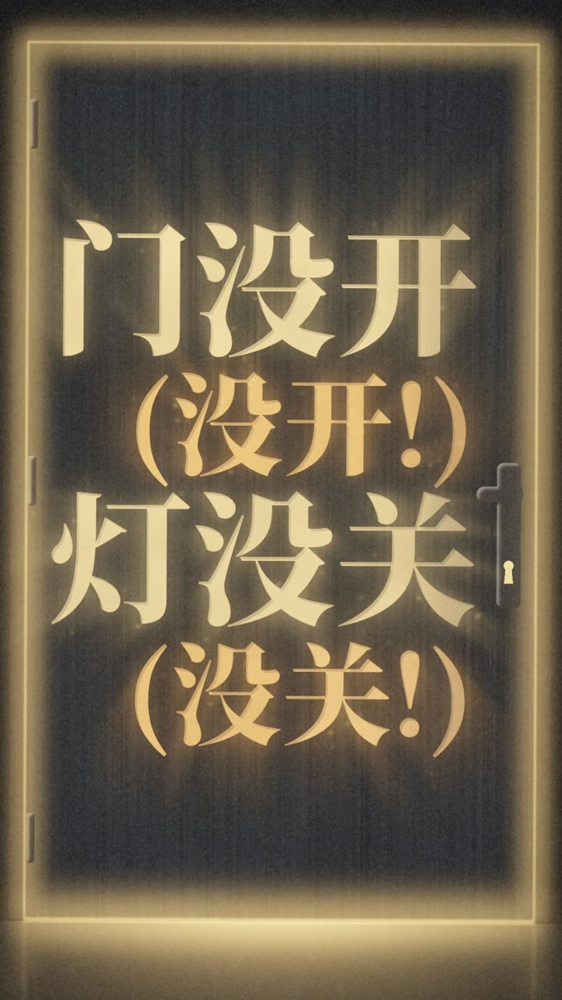

# 2026-11-17 · Bring Jensen Back 2.0 · 门没开，灯没关（melody1 版）

> 同一天另有一支 [melody2 版](../2026-11-17-01-bring-jensen-back-week-two/)（5:03），由另一个会话同时独立完成。两边没有互相参考，都从歌名得出了"字是门上透光的洞"。差别在做法：那一支每段换一扇门、用逐拍跟踪的鼓点驱动；这一支只有一扇门，变化放在镜头距离（门前 / 走廊）、光的颜色和 Drop 的极性翻转上，逐字时间用两个对齐器互相校验。

| 项 | 内容 |
|---|---|
| 日期 | 2026-11-17 |
| 类型 | 华语旋律说唱的歌词 MV，9:16。画面全部由程序计算（一扇关着的门、走廊、一座塔），没有用图片或视频生成模型 |
| 工具 | Claude Code；numpy / scipy / OpenCV / Pillow；faster-whisper（large-v2、medium、small）、torchaudio MMS 对齐模型（CTC）、UVR Kim_Vocal_2（人声分离），均为本机 CPU；ffmpeg |
| 输入 | Suno 生成的 `bring jensen back 2.0 chinese-melody1 门没开，灯没关.mp3`（5:01.2）和提示词里贴的歌词全文，用户提供，**不入库** |
| 产出 | 成片 1 条 + 分享版 1 条 |
| 状态 | 2026-11-17 完成。实际演唱与歌词单有四处出入、旋律段逐字时间的把握有限，均已列给作者 |

## 成片

| 预览 | 文件 | 时长 | 规格 | 大小 |
|---|---|---|---|---|
|  | [`media/bring-jensen-back-door-light.mp4`](media/bring-jensen-back-door-light.mp4)（母版） | 5:01.2 | 1080×1920 · 30 fps · H.264 5.5 Mbps 两遍（BT.709）· 音轨为原曲 MP3 流原样复制 | 214.4 MB |
| | [`variants/share/bring-jensen-back-door-light_share.mp4`](variants/share/bring-jensen-back-door-light_share.mp4)（分享版） | 5:01.2 | 同上，2.2 Mbps，编码前轻降噪 | 90.1 MB |

两条成片经 Git LFS 提交在本次的分支上（云端直接推送），为的是不随云端容器回收而丢失。歌词点名真实人物并写到具体事件，属于作者本人的创作；合并进主分支、是否放上展示网站由作者决定（这次没有改 `site/`）。SHA-256：母版 `c2e41b24…6a80`，分享版 `783ce66b…1050`。

逐帧预览：[每 4 秒一帧](thumbs/bring-jensen-back-door-light_sheet.jpg) · 每句一帧：[全部 101 次演唱](thumbs/bring-jensen-back-door-light_lines.jpg) · 时间对齐校验：[逐字起点画在人声频谱图上](thumbs/bring-jensen-back-door-light_timing.jpg)（标签是字在句中的序号，不含歌词）。

校验：两条成片的音频包 MD5 都与原曲一致（`33fdbe9d…bf96`），30 / 100 / 165 / 230 / 290 s 互相关偏移 0.00 ms；9036 帧，视频 301.200 s、音频 301.176 s（相差 24 ms，不到一帧）；从成片抽帧确认：副歌第一个词在 80.267 s 的那一帧已经亮起（定时 80.26 s）、Drop 的第一个字出现在 159.567 和 159.667 s 两帧之间（定时 159.66 s）、最后一句的第一个字出现在 293.0 s 的那一帧（定时 293.00 s）。

**一句话：** 歌名就是规则。门没开，所以要看见里面的灯，只能透过字：每个字在被唱出的那一帧在门板上切开，灯光从字的形状里漏出来；一句唱完光灭了，切口留成一道疤。镜头退到走廊另一头时，歌词是门槛下铺到地上的那片光里的字，新的一句把旧的一句往门的方向推回去。Drop 把规则翻过来：整扇门自己烧亮，字成了唯一黑的东西。门自始至终没有开。

歌曲分析、规则和分段见 [storyboard.md](storyboard.md)，提示词和过程见 [prompt.md](prompt.md)。

## 第三方素材（不入库，只登记）

| 素材 | 来源 | 体积 | 为什么不入库 |
|---|---|---|---|
| 歌曲 | 用户用 Suno 生成（MP3 元数据：artist `annasu82`，`made with suno`，2026-11-17） | 7.0 MB | 原曲不入库；成片以它为音轨 |
| 歌词 | 用户写在提示词里 | 约 5 KB | 只存在于 `work/`（不入库）；脚本按句序和字序引用，不含歌词文本 |

## 关键制作步骤

1. **量歌。** 84.99 BPM，一小节 2.824 s，主歌一句一小节；鼓在 24.13 s 进来；歌词单上写的"鼓抽掉 / 鼓全停"实测没有发生，真正变薄的是 Build 和 Bridge 的开头；Drop 在 159.68 s，口号实际连唱了三遍。每一项对应到画面上的一个决定，见 storyboard 第 1 节。
2. **逐字对时间。** 分离人声 → 整首转写确认顺序 → Whisper 和 CTC 两个强制对齐器各 12 个估计取中位数 → 两者一致处当锚点、其间按音节均匀分布（说唱段）或以 Whisper 为主（旋律段）→ 吸附到人声起音峰 → 对着频谱图或起音列表手工定了 32 句里的全部或部分字。见 storyboard 第 4 节。
3. **定规则。** 字是门上透出来的光（近景）/ 门槛下铺在地上的光（远景）；颜色按段落的意思换；Drop 翻转；间奏换一座城。见 storyboard 第 2 节。
4. **排版。** 每句按歌词单自己的空格分行，每行撑满门宽，字号由行的长短决定，所以短语越短字越大（`typo.py`）。标点跟着它前面或后面的字走；排版模块逐行断言"屏幕上的字符 = 歌词单的字符"。
5. **写渲染器。** 门板、门缝漏光、地面倒影是预先算好的贴图；每帧只算三张图：几何（哪里被切开）、发光（现在有多少光透出来）、染色。发光图缩到 1/4 做辉光和放射状的光柱，再和门板合成（`door.py`）。远景把近景那一帧缩成门的大小贴进走廊，再把地面文字按透视投到地板上，所以推拉镜头是连续的（`mv.py`）。
6. **音轨不动。** 原曲 MP3 流原样复制进 mp4。

## 实际演唱和歌词单的出入（交付时已列给作者）

见 storyboard 第 1 节的表。概括：Drop 的口号连唱了三遍（画面出现三遍）；Drop 之后的两个三字短句没有唱（没有上屏）；Build 里两个说话人标签、两遍副歌里歌名句的第一声应答听不出独立的音节（作为名牌 / 回声出现）；最后一句唱了两遍（亮两次）。

## 素材与费用

| 素材 | 来源 | 费用 |
|---|---|---|
| 画面 | 本机程序计算，9036 帧（30 fps） | 免费，按 10 秒分 31 段、4 进程并行渲染约 45 分钟 |
| 识别与强制对齐 | faster-whisper 3 个模型 + MMS 对齐模型，本机 CPU | 免费 |
| 人声分离 | UVR Kim_Vocal_2 ONNX，本机 CPU | 免费 |
| 字体 | Noto Sans SC Black、Noto Serif SC Black、Anton、Playfair Display Black Italic、JetBrains Mono Bold（均为 OFL，经 Google Fonts，中文只取用到的字） | 免费 |

## 复盘

**做得好**
- 规则是从歌名里直接长出来的，而且 9:16 的画幅本身就是一扇门的比例，所以"字要大到撑满画面"和"字是门上的切口"是同一件事。
- 没有只信一个对齐器。Whisper 和 CTC 的错法不同，放在一起才看得出谁在哪里错；相邻两句时间重叠这一条自检抓出了第三段主歌开头 0.7 秒的错位。
- 没有照着歌词单上的编曲备注做画面，而是先量了这个生成版本里到底发生了什么。

**踩坑 / 注意**
- 节拍脚本被 trap 的三连音带到了 70.8 BPM。量出来的速度要拿"一句歌词多长"这种独立的事实对一下。
- CTC 对齐器每句的第一个和最后一个字会漂进相邻的句子；副歌一有合唱它就失灵（路径的平均后验概率掉到 0.05 以下）。
- 旋律段里连着唱的几个字在频谱图上是一条不断的谐波，看不出字的边界，这些地方只能相信对齐器，误差大约 ±0.1–0.2 秒。
- 用 `pkill` 停掉渲染主进程后，子进程还活着并继续往同一个日志里写，容易误以为新的一轮出错了。

**下次可以试**
- 把门的近景做成能被"敲"变形的网格，让应答的那一拳真的在门板上留下凹痕。
- 远景里让地上的字被走过的人影挡住。
- 把"切口 + 发光 + 染色"三张图的合成抽成通用的歌词层，换一种表面（墙、车窗、手机屏）就是另一支片子。
