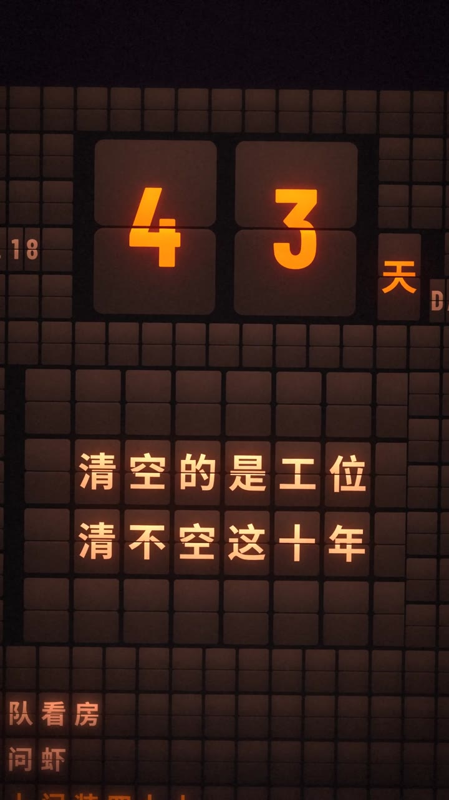

# 2026-11-18 · Countdown 43 · 一面机场翻牌屏，整夜倒数

| 项 | 内容 |
|---|---|
| 日期 | 2026-11-18 |
| 类型 | 华语说唱（boom bap / trap / EDM）的歌词 MV，9:16。画面全部由程序计算（厦门高崎机场出发大厅的一面翻牌屏），没有用图片或视频生成模型 |
| 工具 | Claude Code（云端）；numpy / scipy / OpenCV / Pillow；faster-whisper（large-v2、medium）、torchaudio MMS 对齐模型（CTC）、UVR Kim_Vocal_2（人声分离），均为本机 CPU；ffmpeg |
| 输入 | 用户提供的 `Countdown 43 - mandopop1 - musicful.mp3`（5:29.97）和 `Countdown 43 lytics.txt`（歌词），**不入库** |
| 产出 | 成片 1 条 + 分享版 1 条 |
| 状态 | 2026-11-18 完成。逐字时间来自两个对齐器加手工修正，请作者看的时候留意哪一句的字和演唱对不上 |

## 成片

| 预览 | 文件 | 时长 | 规格 | 大小 |
|---|---|---|---|---|
|  | [`media/countdown-43.mp4`](media/countdown-43.mp4)（母版） | 5:30.0 | 1080×1920 · 30 fps · H.264 5.2 Mbps 两遍（BT.709）· 音轨为原曲 MP3 流原样复制 | 219.6 MB |
| | [`variants/share/countdown-43_share.mp4`](variants/share/countdown-43_share.mp4)（分享版，适合微信等转发） | 5:30.0 | 同上，2.0 Mbps，编码前轻降噪 | 87.8 MB |

两条成片经 Git LFS 提交在本次的分支上（云端直接推送）。歌里写的是作者本人这一年的经历；合并进主分支、是否放上展示网站由作者决定（这次没有改 `site/`）。SHA-256：母版 `db585011…a788`，分享版 `55f33921…2349`。

逐帧预览：[每 4 秒一帧](thumbs/countdown-43_sheet.jpg) · 每句一帧：[全部 114 句，各在最后一个字唱出后 0.15 秒](thumbs/countdown-43_lines.jpg) · 时间对齐校验：[逐字起点画在人声频谱图上](thumbs/countdown-43_timing.jpg)（标签是"第几句.第几个字"，不含歌词）。

校验：两条成片的音频包 MD5 都与原曲一致（`c5bb7144…0367`），30 / 100 / 170 / 240 / 300 s 互相关偏移 0.00 ms；9900 帧，视频 330.000 s、音频 330.00 s；从成片逐帧抽查：第 10 句第一个字在 32.47 s 那一帧翻到位（定时 32.472 s），尾声计数器的"2"在 314.25–314.35 s 之间落定（定时 314.262 s）。

**一句话：** 歌里有三个时间：世界的 2026 年、我的第十年、还剩 43 天的今天。画面是厦门高崎机场出发大厅里的一面翻牌屏，一个通宵：每个字在被唱出的那一帧翻到位；主歌的每一句写进墙上的四栏，越写越满，直到「一键清零」把整面墙翻回空白；最后一遍副歌的「重写一遍」让整面墙把这一年重新写回来。墙顶上的计数器整夜是 43，只有天亮时说到「明天」的那一句让它真的翻到 42。

歌曲分析、规则和分段见 [storyboard.md](storyboard.md)，提示词和过程见 [prompt.md](prompt.md)。

## 第三方素材（不入库，只登记）

| 素材 | 来源 | 体积 | 为什么不入库 |
|---|---|---|---|
| 歌曲 | 用户提供（文件名标注 musicful 生成，MP3 元数据里没有署名） | 5.3 MB | 原曲不入库；成片以它为音轨 |
| 歌词 | 用户提供的 txt | 5.5 KB | 只存在于 `work/`（不入库）；脚本按句序和字序引用，不含歌词文本 |

## 关键制作步骤

1. **量歌。** 90.00 BPM，整首不漂，一小节 2.667 s，底鼓在 1、3 拍；主歌一句一小节。Bridge（224.5–246.1 s）是全曲唯一鼓全停的一段，尾声的念白段鼓也停，315 s 起鼓又回来。每一项对应到画面上的一个决定，见 storyboard 第 1 节。
2. **定规则。** 从歌词里取：机场（尾声的两条跑道）+ 倒计时（还剩 43 天）+ 一年（一月到十一月）= 机场出发大厅的翻牌屏。字是翻牌：在被唱出的那一帧翻到位；主歌写进墙里留着；「一键清零」清空整面墙；「重写一遍」把一年写回来；计数器只在天亮时翻到 42。见 storyboard 第 2 节。
3. **翻牌。** `flap.py`：每块翻牌是上下两半，换字时上半片朝镜头翻下、压扁到转轴，过了 90° 露出背面（新字的下半），落下盖住旧字的下半；每帧在快门时间内取三个相位平均，得到运动模糊。落定一个字之前先翻过 3–4 个别的字，最后一翻正好结束在这个字被唱出的时刻。
4. **墙。** `wall.py`：墙是 45 × 51 格的翻牌（公告栏的翻牌大一号），每块翻牌有自己的寿命，一句歌词的翻牌在各自开始转动前一刻才出现，其余地方由空白翻牌补齐；英文字母是半宽的翻牌，空白的整格和两个半格只在都是空白时互换。渲染时按镜头可见范围挑一档分辨率，把可见的翻牌拼成一张图，再用一个透视矩阵投到画面上。
5. **排版。** `layout.py`：按歌词单自己的空格分行，标点跟着它前后的字；圆括号里的和声用琥珀色字，AI 用红色翻牌，重启 / Reset / Respawn 用绿色翻牌。每一行都断言"屏幕上的字符 = 歌词单这一行去掉空格和破折号后的字符"。
6. **镜头和光。** `score.py` 给出每一句的取景（主歌按句左对齐取景、句子越短推得越近）和主光的位置；`render.py` 按段落换光（暖黄 / 冷蓝 / 紫蓝 / 黎明），底鼓推镜和提亮，副歌第一拍闪白，Drop 的绿波，黎明斜射的窗格光带，墙外是大厅虚化的灯和地面倒影。
7. **逐字时间。** 见 storyboard 第 4 节。
8. **音轨不动。** 原曲 MP3 流原样复制进 mp4。

## 素材与费用

| 素材 | 来源 | 费用 |
|---|---|---|
| 画面 | 本机程序计算，9900 帧（30 fps） | 免费。10 秒一段、33 段、4 进程并行渲染约 35 分钟；修正关键光之后重渲了其中 15 段 |
| 转写与强制对齐 | faster-whisper medium、large-v2 + torchaudio MMS 对齐模型，本机 CPU | 免费（Whisper 三种组合的强制对齐共约 1 小时） |
| 人声分离 | UVR Kim_Vocal_2 ONNX，本机 CPU | 免费（约 5 分钟） |
| 字体 | Noto Sans SC Bold（汉字翻牌）、Barlow Condensed Bold（英文字母和数字翻牌），均为 OFL，经 Google Fonts，汉字只取用到的字 | 免费 |

## 脚本

| 脚本 | 用途 |
|---|---|
| `lyrics.py` / `layout.py` | 解析歌词单（方括号是标注、圆括号是和声）；把一句排成翻牌格，逐行断言字符和歌词单一致 |
| `flap.py` | 一块翻牌：字形、翻牌面、折叠动画 |
| `wall.py` | 有寿命的翻牌、自动补齐的空白翻牌、镜头和按可见范围的整墙渲染 |
| `score.py` | 整支片子：每句落在哪、计数器、清空 / 重写 / 绿波、镜头和主光的时间表 |
| `post.py` / `render.py` | 光、辉光、景深、调色、颗粒、大厅和地面倒影；按段并行渲染 |
| `separate_vocals.py`、`asr_windows.py`、`split_windows.py`、`map_lines.py`、`rough_map.py` | 人声分离、分窗转写、定每句的粗略位置 |
| `align.py`、`ctc_align.py`、`timing.py`、`timing_seen.py` | 两个强制对齐器、合并、手工修正 |
| `onsets.py`、`vocal_spectrogram.py`、`marks.py`、`qc_lines.py`、`qc_audio.py`、`sheet.py` | 起音列表、频谱图检查、每句一帧、音轨校验、拼图 |
| `finish.py`、`finish_all.sh` | 拼接、原样复制音轨、母版和分享版 |

## 复盘

**做得好**
- 规则的三次转折（一键清零、重写一遍、43 → 42）都直接来自歌词里最重的几句，所以画面上最大的三件事和歌里最重的三句是同一件事。
- 字一直留在墙上：主歌越往后，镜头上方的旧句子越多，到「一键清零」时被清掉的是看得见的一整年。
- 两个对齐器互相校验之外，chant 段（Drop、机器人报数）直接用转写的词时间加起音手工给，没有硬让对齐器去猜。

**踩坑 / 注意**
- 整首转写在 DJ 搓碟上陷入循环（"二二二二……"、"20,20,20……"），把后面十几秒也带坏了。窗口要避开搓碟。
- 公告栏第一版在下一句开始前 0.7 秒就清屏，副歌里一句完整的字几乎看不到；第二版逐行替换又让两句混在一起。最后定为：旧句一直留到新句的第一个字落下，只有新句第一行要用的那几格提前让出来。
- Whisper large-v2 的强制对齐在 4 核 CPU 上一个窗口要好几秒，226 个窗口 × 3 种组合跑了一个小时；CTC 对齐只要几分钟。

**下次可以试**
- 把翻牌墙抽成通用的歌词层（换一种墙：车站、球场记分牌）。
- 给翻牌加上声音的可视化（每次落定的"咔嗒"让翻牌轻微回弹）。
