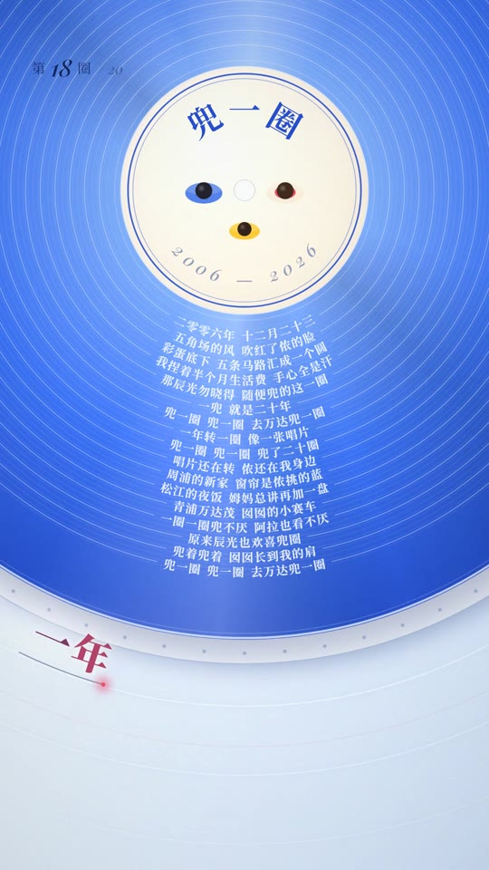

# 2026-11-25 · 兜一圈 · 一句一圈，刻进唱片

| 项 | 内容 |
|---|---|
| 日期 | 2026-11-25 |
| 类型 | 一首 2:47 的原创歌曲（作者为"万达入沪20载 AI歌曲创作大赛"写的参赛作品，普通话演唱、沪语用词）的 MV，9:16。歌词随演唱逐字出现，画面全部由程序计算，没有用图片、视频或地图素材 |
| 工具 | Claude Code（云端）；skia-python（矢量绘制）、numpy / OpenCV（后期）；faster-whisper large-v2、torchaudio MMS 对齐模型（CTC）、UVR Kim_Vocal_2（人声分离），均为本机 CPU；ffmpeg |
| 输入 | 作者提供的成品歌曲 mp3（2:47.23）和最终歌词 txt，**不入库** |
| 产出 | 成片 1 条 + 分享版 1 条 |
| 状态 | 2026-11-25 完成。我听不到声音：逐字时间来自识别、强制对齐和人声轨的测量，没有人听过，请作者看的时候留意哪一句的字和演唱对不上（见"请留意"） |

## 成片

| 预览 | 文件 | 时长 | 规格 | 大小 |
|---|---|---|---|---|
|  | [`media/dou-yi-quan.mp4`](media/dou-yi-quan.mp4)（母版） | 2:47.2 | 1080×1920 · 30 fps · H.264 6.0 Mbps 两遍（BT.709）· 音轨为原曲 MP3 流原样复制 | 129.3 MB |
| | [`variants/share/dou-yi-quan_share.mp4`](variants/share/dou-yi-quan_share.mp4)（分享版，适合微信 / 小红书转发） | 2:47.2 | 同上，2.2 Mbps，编码前轻降噪 | 49.6 MB |

逐帧预览：[每 4 秒一帧](thumbs/dou-yi-quan_sheet.jpg)。分享版已放上[展示网站](https://anna-sap.github.io/Fun-Videos-Anna/)：作品第 12 支，制作历程里有一节，示意图是圆的四个时刻（走出一个圆、一句一圈、荡开、下一张）。SHA-256：母版 `57fbefff…5223`，分享版 `90468886…89da`。

校验：两条成片的音频包 MD5 都与原曲一致（`db5d72f7…cb0a`），16.7 / 58.5 / 100.3 / 142.1 s 互相关偏移 0.00 ms；5017 帧，视频 167.233 s、音频 167.22 s；从成片抽查 6 个字（主歌、副歌、Bridge、念白、最后一遍副歌各取一个）：起点前 0.13 s 的那一帧都还没有这个字，起点后 0.07 s 的那一帧都已经出现。

**一句话：** 这首歌里"兜一圈"是逛一圈、一年、唱片转一圈、涟漪。量出来的事实是：一句歌词正好两小节，到 Bridge 之前正好唱了 20 句。所以片子里唱片每两小节转一圈，每唱完一句，这一句就绕成一圈刻进唱片，从里往外像年轮一样长；第二遍副歌唱完，唱片上正好 20 圈。Bridge 里一滴水把这 20 圈荡出去，从五角场荡到临港的滴水湖；那个圆的湖，就是最后一遍副歌里的"下一张唱片"。

歌曲分析、规则和分段见 [storyboard.md](storyboard.md)，提示词和过程见 [prompt.md](prompt.md)。

## 请留意

- **逐字时间没有人听过。** 每个字是 5 个估计的中位数，三遍副歌互相校验的误差约 ±0.03 s；句首和人声轨的电平对过。最没把握的是两句念白和道别那句（说话没有节拍可以参照），以及每句拖长的最后一个字。
- **录音和歌词文件有两处不一样**，画面按歌词文件：念白第三句末尾的语气词在录音里没有找到，画面上它紧跟前一个字出现；道别那句的头两个字在录音里念了两遍，画面只写一遍，第二遍时那两个字跳一下。
- 尾奏 153.8–157.5 s 有一段人声，转写模型在这里只给出幻觉文字，频谱上是有音高的元音，判断为无词的哼唱，所以没有配字。如果其实有词，这里少了一句。
- 上海地图是手工放的二十几个点连成的示意图，只保证五个地方的相对方位，不是真实比例；滴水湖离海比实际画得近。场景里的五角场、新家、饭桌、赛车场都是按歌词想象画的，不是实景。
- 画面里写了"万达入沪二十载"和五个地名，没有使用万达的标志或任何第三方图形。
- 刻进唱片的歌词在俯拍镜头里只有十几像素高，是当纹理看的；想读它的地方是第二遍副歌前半（镜头跟着唱片转的那 8 秒）。

## 第三方素材（不入库，只登记）

| 素材 | 来源 | 体积 | 为什么不入库 |
|---|---|---|---|
| 歌曲 | 作者自己的参赛作品（MP3 标题字段"兜一圈"，内嵌一份歌词，没有署名字段） | 3.8 MB | 原曲不入库；成片以它为音轨 |
| 歌词 | 作者提供的 txt | 1.4 KB | 只存在于 `work/`（不入库）；脚本按句序和字序引用，不含歌词文本 |

## 关键制作步骤

1. **量歌。** 分离人声；从伴奏的起音逐拍跟踪（速度从每拍 0.541 s 慢慢缩到 0.5285 s，不能用固定网格）；逐拍电平表读出段落和两处伴奏全停。每一项对应到画面上的一个决定，见 storyboard 第 1 节。
2. **定规则。** 一句 = 两小节 = 唱片一圈；唱完刻进唱片；念白不刻；Bridge 反过来向外荡开。见 storyboard 第 2 节。
3. **钟。** `score.py`：拍点、唱片转角（直接读拍点，所以跟着歌一起变快；结尾的静默里滑行到停）、每句刻入的强拍、车流和风用的"会在静默里停住"的钟。
4. **唱片和歌词。** `disc.py`：一句歌词的三种状态（在弧线上逐字出现、收进唱片、作为一圈刻纹跟着转）是同一个函数里的一个参数；每唱到"圈"字从唱片边送出一圈光。
5. **场景。** `scenes.py`、`water.py`：五角场、新家、夜饭桌、赛车场和公园、夜里的上海和滴水湖、清晨的地图，全部俯视，全部以同一个圆心为中心，用 Skia 画矢量图形。
6. **机位。** `render.py`：场景和唱片之间用"光圈"收放；第二遍副歌前半在乐句强拍上把镜头锁到唱片上一起转。
7. **逐字时间。** 两遍转写 + 三种 CTC 对齐，取最大一簇的中位数，副歌三遍互校，句首对电平。见 storyboard 第 5 节。
8. **音轨不动。** 原曲 MP3 流原样复制进 mp4。

## 素材与费用

| 素材 | 来源 | 费用 |
|---|---|---|
| 画面 | 本机程序计算，5017 帧（30 fps） | 免费。10 秒一段、17 段、4 进程并行渲染约 9 分钟 |
| 转写与强制对齐 | faster-whisper large-v2 + torchaudio MMS 对齐模型，本机 CPU | 免费（各几分钟） |
| 人声分离 | UVR Kim_Vocal_2 ONNX，本机 CPU | 免费（约 4 分钟） |
| 字体 | Noto Serif SC、Noto Sans SC、Playfair Display（经 Google Fonts）、霞鹜文楷（GitHub 发布页），均为 OFL | 免费 |

## 脚本

| 脚本 | 用途 |
|---|---|
| `lyrics.py` | 解析歌词单（方括号是标注，`[Spoken]` 之后是念白）；断言行数和句数 |
| `score.py` | 拍点、唱片转角、每句的时间和刻入时刻、段落边界 |
| `kit.py` | Skia 上的颜色、字体、单字旋转绘制、缓动和关键帧 |
| `disc.py` | 唱片、刻纹、弧线上的歌词、唱臂、圈数、念白 |
| `scenes.py` | 各段的风格表；五角场、新家、夜饭、赛车场 / 公园；唱盘和标签 |
| `water.py` | Bridge 到结尾：水滴、松开的 20 圈、地图、鲸鱼、新唱片、道别、片尾 |
| `render.py` | 机位时间线、合成、后期（辉光、暗角、颗粒）、单帧预览、分段并行渲染 |
| `separate_vocals.py`、`asr_full.py`、`asr_clip.py` | 人声分离、整首转写、片段多次转写 |
| `tempo.py`、`feat.py`、`beats.py` | 分段测速、起音包络、逐拍跟踪和逐拍鼓表 |
| `ctc.py`、`align.py`、`timing.py`、`hand_times.json`、`qc_starts.py` | CTC 对齐、5 种估计、合并、手工改的 5 个字、句首对电平 |
| `analyze_audio.py`、`analyze_structure.py`、`vocal_spectrogram.py` | 响度 / 频段 / 速度候选、逐小节表、频谱图 |
| `fetch_fonts.py`、`onscreen.txt` | 下载字体并只保留用到的字 |
| `finish.py`、`finish_all.sh`、`qc_audio.py`、`sheet.py` | 拼接、原样复制音轨、母版和分享版、音轨校验、拼图 |

## 复盘

**做得好**
- 规则不是想出来的，是数出来的：数句子数到 20 的那一刻，歌词里的"二十圈"和画面就接上了，后面的决定（一句一圈、每两小节转一圈、Bridge 向外荡开、新唱片从第 1 圈开始）都是它的推论。
- 所有场景共用一个圆心和一个俯视角度，换场景只是换"圆里是什么"，转场用同一个光圈就够了。
- 逐拍跟踪而不是固定网格：这首歌全程在慢慢变快，固定网格到结尾会差出两拍多。

**踩坑 / 注意**
- 通用结构分析把 112 BPM 量成 74（3:2），整张逐小节表因此是错的。用"一句歌词多长"核对速度应该是第一步。
- 刻纹一开始从外往里长，歌词扇面读起来是倒序的；改成从里往外之后三件事同时顺了（阅读顺序、新句子接在下面、Bridge 向外荡开）。
- 特写里"等歌词转过来"大部分时间是空的。镜头跟着唱片转，比等它转过来好。
- 浅色场景里辉光会把白色的东西冲成一片，辉光强度要跟着场景走。

**下次可以试**
- 用图片模型给每个地方出一张俯视的关键帧，替换程序画的场景，规则层不用动。
- 刻纹里的字再大一些（减少圈数或加大唱片），让俯拍时也能读。
