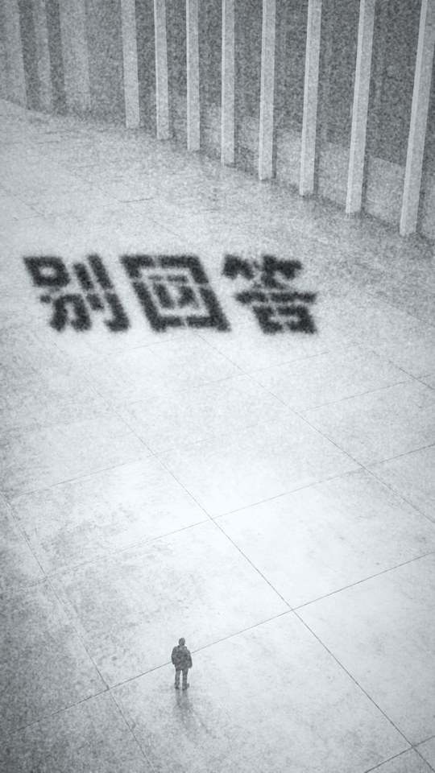

# 2026-11-25 · 别回答 · Coldwave 版：被照到就是暴露

| 项 | 内容 |
|---|---|
| 日期 | 2026-11-25 |
| 类型 | 《别回答》Coldwave / Darkwave 版（4:24）的 9:16 歌词 MV。AI 关键帧 + 本地渲染（景深投影、雾、光束、雪、胶片），没有用视频生成模型 |
| 工具 | Claude Code（云端），按 `lyric-mv` Skill 的流程；gpt-image-2（26 张关键帧 + 6 张重做）；Depth Anything V2 Small、faster-whisper large-v2、torchaudio MMS 对齐模型、UVR Kim_Vocal_2、jieba，均为本机 CPU；numpy / OpenCV / Pillow；ffmpeg |
| 输入 | 作者提供的成品歌曲 mp3 和最终歌词 txt，**不入库** |
| 产出 | 成片（母版）1 条 + 分享版 1 条 |
| 状态 | 2026-11-25 完成。检查点 1 之后，用户选择方案 A、取消检查点 2 和 3，一路做到成片。我听不到声音：时间全部来自测量和对齐，见"请留意" |

## 成片

| 预览 | 文件 | 时长 | 规格 | 大小 |
|---|---|---|---|---|
|  | [`media/bie-huida-coldwave.mp4`](media/bie-huida-coldwave.mp4)（母版） | 4:24.4 | 1080×1920 · 24 fps · H.264 7.0 Mbps 两遍（-tune grain）· 音轨为原曲 MP3 流原样复制 | 236.1 MB |
| | [`variants/share/bie-huida-coldwave_share.mp4`](variants/share/bie-huida-coldwave_share.mp4)（分享版） | 4:24.4 | 同上，1.6 Mbps，编码前轻降噪 | 57.3 MB |

逐帧预览：[每 4 秒一帧](thumbs/bie-huida-coldwave_sheet.jpg) · [歌词的 15 种状态和桥段事件前中后](thumbs/bie-huida-coldwave_states.jpg) · [26 张关键帧](thumbs/bie-huida-coldwave_keyframes.jpg)

校验（`qc_audio.py`、`qc_cuts_grid.py`）：两条成片的音频包 MD5 都与原曲一致（`9ba27121…542b`），30 / 90 / 150 / 230 s 互相关偏移 0.00 ms；母版 6345 帧（264.375 s）、分享版 6343 帧，音频 264.432 s（最后几十毫秒的余响落在最后一帧之后，那里画面已经是黑的）；27 个硬切相对逐拍网格的偏差都在 0.5 帧以内（取整到帧）。场景检测另外报出 12 处"不在拍上"的亮度跳变，都是镜头内跟着声音走的光：K10 泛光按人声起音灭亮、Chorus 2 行 4 下面按伴奏的 8 分音符断续、K19 爆开的白光在扩散。SHA-256：母版 `0bf4a892…c684`，分享版 `1534f7c8…1c4b`。

**一句话：** 歌里那句警告的意思是：一回应就会暴露位置。所以片子里被照到就是暴露：主歌的字是探照灯透过镂空字模打在场景上的光，副歌泛光灯全开、字变成唯一没被照到的影子；Bridge 伴奏抽空的 14.37 秒里整个世界停住，乐队砸回来的那一拍白光压下，整个太阳系被晒成一张蓝晒相纸。

歌曲分析、测量和镜头表见 [storyboard.md](storyboard.md)，提示词和过程见 [prompt.md](prompt.md)。

## 量出来的事实 → 画面

| 量到的 | 变成了 |
|---|---|
| 速度从 111 漂到 114.5 BPM，第 65 小节只有两拍 | 逐拍跟踪的 498 拍网格；30 个镜头里 27 个硬切全部落在网格上（偏差 ≤ 0.5 帧，取整到帧）；第二遍副歌早到两拍，那两拍只剩噪声底，画面跳一帧，泛光灯打在第 66 小节第 1 拍 |
| 鼓机四踩，噪声军鼓在 2、4 拍 | 光读的是真实的底鼓起音：K08 的光点、V2 行 9–12 的光束亮度；K11 的舰灯每记军鼓灭一排、闪一下白 |
| V2 行 10（心跳停下那句）鼓机正好停一个小节 | K14 的光束读底鼓，这一小节里平成一条线，没有另外设计 |
| 第 35–38 小节只有底鼓 | Pre-Chorus 行 5–6 的 K08 里，只有黑板前那一点光在跳 |
| STATIC 16 处：10 次宽频噪声 burst 在段落第一拍、5 次鼓机停下时露出的噪声底、片尾一次 | burst 闪白 1 帧，噪声底让片门跳一帧；片名在两次 burst 之间出现和消失 |
| GAP 172.67–187.04 s，在 Bridge 行 1–3 下面；乐队在行 4 回来 | 方案 A：K20 那张纸停在半空，雾、颗粒、片门抖动全部停住 14.37 秒；乐队回来那一拍白光从上方压下，两句推到全白；行 6 显影成 K21 |
| 三次副歌第一拍 81.954 / 138.396 / 224.874 s；全曲最响是最后一遍副歌开头（短时 −10.0 LUFS） | 前两次泛光灯在这一拍打开；第三次是全曲最响的地方，画面反而让泛光渐灭、影子散掉 |
| Outro 有周期 4.19 s（两小节）的次低频脉冲 | 最后那束从下往上的光按 4.19 s 明灭，亮点在第 123、125 小节；音频 264.46 s 到头，263.75 灯灭，264.04 硬切黑 |
| 歌词差异：Intro 15.3–17.3 s 多出一段无词人声；"滴答"只确认唱了一遍 | 前者不配字；后者泛光按测到的四个人声起音灭、亮、灭、亮，字按歌词文件显示两遍 |

## 歌词规则在各段的状态

| 段 | 状态 |
|---|---|
| Intro | K01 墙上的小字光斑（约一半宽）；片名一次，大字 |
| Verse 1 | 光：画面压暗 2.5 档、罩雾；字是透过镂空字模（思源黑体 Heavy + 程序切出的细断口）的光，用景深图投到场景上、在纵深断开处错开；逐字从左到右扫亮，唱完光束移走。行 6 第一次落到人的肩背上 |
| Pre-Chorus | 光，扫亮和移走都快一倍 |
| Chorus 1 | 影：泛光过曝，字是斜躺在广场上的黑影（比人大几十倍），行 3–5 的影子落在灯罩玻璃上，"滴答"时随灯灭而消失 |
| Verse 2 | 行 1–4 光，行 4 随舰灯一截一截灭；行 5–8 灯全灭，字是雾里更黑的剪影；行 8 末三字被光猛地照中、过曝、什么都不剩；行 9–12 光，亮度随底鼓 |
| Chorus 2 | 影，两束对射的光给每个字方向相反的两重影子，落在雪地上 |
| Verse 3 | 光 |
| Bridge | 行 1–3 整句浮现的微弱漫射白（GAP 里画面完全静止，只有字在出现）；行 4–5 随画面被白光吞没；行 6 是蓝晒相纸上的白色剪影 |
| Verse 4 | 蓝调上的白色细字（Heavy 腐蚀变细、每字随机歪斜几度），像纸字压在相纸上晒出的印子 |
| Final Chorus | 行 1 影子随泛光渐灭而散；行 2–5 是窗和灯漏出来的柔光，没有光束；蓝在行 1–3 之间退回中性黑白 |
| Outro | 行 1 墙上小字光斑（与 Intro 同位置）；行 2 由一束从底部竖直打上去的光投在云底 |

## 请留意

- **逐字时间没有人听过。** 每个字最多 4 个独立估计（人声轨 / 混音的 MMS 强制对齐、两次整首转写的词时间），去掉离群值后取中位数，743 个字里 583 个有 4 个估计。最没把握的是 Pre-Chorus 行 1 的起点（估计从 55.4 到 56.4 s 都有）和 Chorus 2 整段（对齐后验很低）。看的时候请留意哪一句的字和演唱对不上。
- **有五句的第一个字比演唱晚 0.14–0.34 s 出现**（V1 行 7、Pre 行 1、V3 行 7、V4 行 2、FC 行 1）：切点必须在拍上，又要让上一句最后一个字先唱完，两者冲突时我让上一句唱完。
- **场景不一致**：K18 的"警示灯墙"是一列一列的金属灯，不是红色警灯；K24 右侧多了一栋混凝土楼（STYLE 带进来的，保留了）；K05、K10 的背景里也有混凝土建筑。人物只有背影和手，没有脸部一致性问题；K02 和 K18 的两个女人发型、外套不同。
- **光斑在亮场景里对比不足**：K22 灯箱和 K06 白雾天空上的白字偏弱（K22 把底片整体压暗、字周围加了一圈暗晕来救）；Chorus 2 雪地上的两重影子在过曝的雾里比较糊。
- **不严格的处理**：雾和光束是二维的近似（三层噪声按景深遮挡），不是真正的体积光；字的"投影"是按景深把字模平移，不是真的投影仪几何；K06 三个太阳的视差是把日轮抠出来平移、背景用修补算法补的；K25 的字没能落在雪地上（雪地全在底部 420 px 的禁区里），落在了小屋上方的雪雾里；夜里的灯（太阳、窗、灯泡）在压暗 2.5 档时保留了高光，否则看不见。
- 主歌整体很暗，这是"压暗 2.5 档"的设计；手机亮度低时可能看不清场景，只看得清字。

## 第三方素材（不入库，只登记）

| 素材 | 来源 | 体积 | 为什么不入库 |
|---|---|---|---|
| 歌曲 | 作者提供的《别回答 - V3 - 424 - coldwave darkwave》mp3（4:24.46，128 kbps） | 4.2 MB | 原曲不入库；成片以它为音轨 |
| 歌词 | 作者提供的 txt，没有署名和权利声明 | 2.8 KB | 只存在于 `work/`；脚本按段落和行号引用，代码和文档里没有歌词原文 |
| 字体 | 思源黑体 CN Heavy（Adobe，SIL OFL），GitHub 发布页 | 8.8 MB | 只在 `work/fonts/` |

## 关键制作步骤

1. **量歌。** 分离人声，逐拍跟踪，按 16 分音符格子读鼓型，宽频噪声和"同位置前后 4 小节"比找 STATIC，逐拍电平找 GAP，ebur128 找最响的一段，读出 Outro 脉冲周期。见 storyboard 第 1–5 节。
2. **检查点 1。** GAP 实测位置和设计默认的不一样，给出方案 A / B，用户选 A。
3. **关键帧。** 26 张一次出完，看总览后重做 6 张（STYLE 的"brutalist concrete"把建筑塞进了火山平原、星空、太空和森林；K18 画成了真镜子里的两个人；K22 画成了整个天文台），提示词只追加澄清句，原文不改。
4. **景深。** Depth Anything V2 Small，本机 CPU，32 张约半分钟。
5. **渲染。** `render.py` 每帧：关键帧 → 曝光（压暗 / 泛光 / 蓝晒）→ 雾 → 歌词层 → 光束 → 雪 → 镜头效果 → 淡入淡出 → 胶片（颗粒、片门抖动、划痕都读同一条会停的钟）→ 上色。6348 帧、200 帧一段、4 进程约 13 分钟。
6. **切点复核。** 第一版切点用的是逐句对齐的起点，有三句的最后一个字在切换前根本没出现；改用逐字时间重算（`plan_cuts2.py`），整片重渲。
7. **合成和校验。** 原曲 MP3 流原样复制进 mp4，两遍 x264；音频包 MD5、四点互相关、硬切对网格。

## 素材与费用

| 素材 | 来源 | 费用 |
|---|---|---|
| 关键帧 | gpt-image-2 medium 1088×1920，26 张 + 重做 6 张（K03 走 edits 带 K02） | **$1.31**（脚本按 token 记账，没有和账单核对；上限 $1.70） |
| 转写与对齐 | faster-whisper large-v2（人声轨、混音各一遍）+ MMS 对齐（逐句，人声轨、混音） | 免费 |
| 人声分离、景深 | UVR Kim_Vocal_2、Depth Anything V2 Small | 免费 |
| 渲染与编码 | 本机 CPU | 免费（渲染约 13 分钟，母版 + 分享版编码约 22 分钟） |

## 脚本

| 脚本 | 用途 |
|---|---|
| `separate_vocals.py`、`asr_full.py`、`ctc.py`、`align_lines.py`、`timing.py`、`opencc_lite.py`、`lyrics.py` | 人声分离、整首转写、MMS 强制对齐、逐字时间合并、歌词文件解析 |
| `analyze_audio.py`、`analyze_structure.py`、`tempo.py`、`feat.py`、`beats.py`、`downbeat.py`、`drum_pattern.py` | 响度 / 速度候选、逐拍跟踪、找强拍（发现两拍小节）、16 分音符鼓型 |
| `static_scan.py`、`static_find.py`、`static_excess.py`、`noise_floor.py`、`static_final.py`、`strip.py` | STATIC 的几种检测和看图用的频谱条 |
| `plan_cuts.py`、`plan_cuts2.py` | 按网格算切点（第一版 / 终版） |
| `keyframes.py`、`oai_image.py`、`gridview.py`、`sheet.py` | 出图（26 条提示词原文 + STYLE + 重做时追加的澄清句）、带坐标网格的看图、拼图 |
| `depth.py`、`run_depth.py` | 景深图 |
| `timeline.py`、`shots.py`、`look.py`、`words.py`、`render.py` | 时间轴和变速的钟、30 个镜头、雾 / 雪 / 胶片 / 上色、排版和镂空字模、每帧合成与分段渲染 |
| `finish.py`、`qc_audio.py`、`qc_cuts_grid.py` | 合成、音轨校验、硬切对网格 |

## 复盘

**做得好**
- 测量真的改了设计：GAP 不在设计以为的地方，检查点 1 把它摆出来，用户选了跟音频走的方案，"静默有多长，静止就有多长"因此是量出来的；"心一停"那一小节鼓机正好停，光束不用设计就平了。
- 一条规则（被照到就是暴露）撑住了 11 段：光、影、剪影、漫射、显影、印子、窗光，都是同一盏灯的不同状态。
- 渲染每帧约 0.3 秒：雾和光束在四分之一分辨率算，再放大。

**踩坑 / 注意**
- STYLE 里写了材质（brutalist concrete），模型会把它当成"画面里必须有的东西"。没有建筑的画面要补一句否定。
- "the mirror image of a woman" 会被画成真的镜子。构图关系要写成构图关系。
- 切点第一次是用逐句对齐的起点算的，句首比逐字合并后的早，导致三句的末字从没出现。切点要在逐字时间定稿之后算，并且检查"每句最后一个字有没有在它的镜头里出现"。
- 安全区（下 420 px）+ 版式（最宽一行 80% 宽）+ "字落在雪地上"在 K25 上互相冲突：小屋本来就在下三分之一。
- 压暗 2.5 档会把画面里的光源一起压没（三个太阳、窗灯），要给高光单独留一条曲线。
- 用 `-shortest` 合成时视频会被裁到音频长度，所以画面要比音频多出至少一帧，才能保证所有音频包都在。

**下次可以试**
- 给 K25 重新出一张小屋在画面中部的图，让窗光的字真的落在雪地上。
- 雾换成按景深分层的真正体积光（光束被近处主体挡住时在雾里留下影子）。
