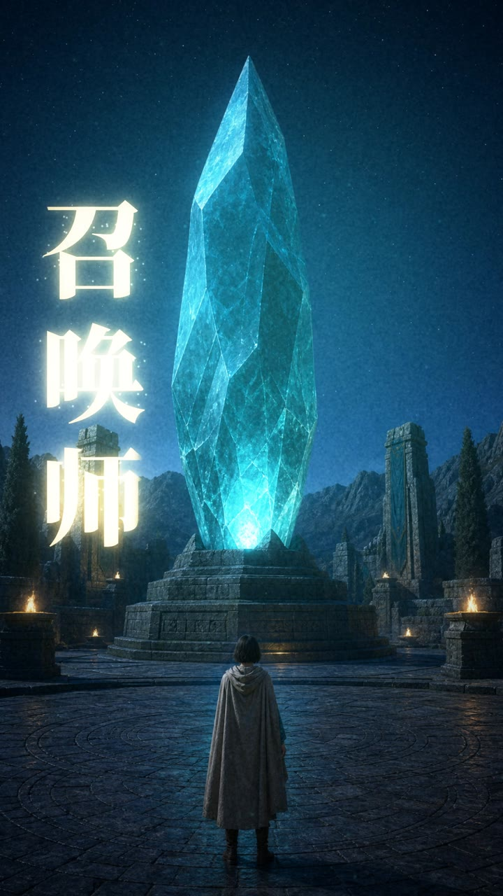

# 2026-11-27 · 三十秒：字是刻进这片土地的符文

| 项 | 内容 |
|---|---|
| 日期 | 2026-11-27 |
| 类型 | 一首 3:57 的华语 euphoric future bass（男声说唱 + 女声副歌，写的是一款 MOBA 游戏的世界：开局前三十秒，老玩家给新人讲整个世界）的 9:16 歌词 MV。AI 关键帧 + 本地渲染（景深视差、粒子、歌词层），没有用视频生成模型 |
| 工具 | Claude Code（云端），按 `lyric-mv` Skill 的流程；gpt-image-2（80 张关键帧 + 2 张人物参考像，重做 9 张）；whisper-1 / gpt-4o-transcribe（转写）；UVR Kim_Vocal_2、MMS 强制对齐、Depth Anything V2 Small（本机 CPU）；numpy / OpenCV / Pillow / librosa；ffmpeg；两个多代理工作流（关键帧审查 14 个代理、整片逐帧检查 44 个代理） |
| 输入 | 作者提供的成品歌曲 mp3 和完整歌词 txt，**不入库** |
| 产出 | 成片（母版）1 条 + 分享版 1 条 |
| 状态 | 2026-11-27 完成，中途没有停下来问。我听不到声音：时间全部来自测量和对齐，见"请留意" |

## 成片

| 预览 | 文件 | 时长 | 规格 | 大小 |
|---|---|---|---|---|
|  | [`media/thirty-seconds.mp4`](media/thirty-seconds.mp4)（母版） | 3:57.6 | 1080×1920 · 24 fps · H.264 7.0 Mbps 两遍 · 音轨为原曲 MP3 流原样复制 | 211.8 MB |
| | [`variants/share/thirty-seconds_share.mp4`](variants/share/thirty-seconds_share.mp4)（分享版） | 3:57.6 | 同上，1.6 Mbps，编码前轻降噪 | 51.5 MB |

逐帧预览：[每 4 秒一帧](thumbs/thirty-seconds_sheet.jpg) · [歌词规则的各种状态](thumbs/thirty-seconds_states.jpg) · [80 张关键帧](thumbs/thirty-seconds_keyframes.jpg)

校验（`qc_audio.py`、`qc_cuts_grid.py`）：两条成片的音频包 MD5 都与原曲一致（`6fd165fc…a836`），30 / 90 / 150 / 220 s 互相关偏移 0.00 ms；母版 5701 帧；场景检测（阈值 0.12）检出全部 85 个计划切点，切点到逐拍网格（四个地名切点到八分音符）的偏差最大 0.78 帧、平均 0.27 帧（取整到帧），另外两个切点按设计落在实测的伴奏停顿起点上。多出来的检测都是设计里的光：段落第一拍的击打、倒数和呐喊的印字。SHA-256：母版 `90a771bf…2afe`，分享版 `114a432f…7e68`（5701 帧）。

**一句话：** 主歌第一句说这片大陆刻满符文，所以片子里的字就是符文：讲述者说唱的每个字被一点白热的光刻进各地的地表、冷却成焦痕；女声唱的句子是水晶的青光，唱完碎成碎片；全曲唯一一次伴奏全停，世界冻结，"召唤师"三个字像碑文一样被刻出来，副歌第一拍碎开。

歌曲分析、测量和镜头表见 [storyboard.md](storyboard.md)，提示词和过程见 [prompt.md](prompt.md)。

## 量出来的事实 → 画面

| 量到的 | 变成了 |
|---|---|
| 速度从 133.9 慢慢加到 136.1 BPM | 逐拍跟踪 534 拍，所有切点查这张网格；说唱每句正好两小节，主歌一句一个镜头、一个地方 |
| Pre-Chorus 1 末尾伴奏全停 1.31 s，"召唤师"唱在里面；第二次 Pre-Chorus 同一个词不停 | 变速时钟归零：火星、沙、雾、推镜头全部悬住，只有这三个字被刻出来；第二次只平常地亮一下 |
| 另外 4 处伴奏停顿（前奏末、Chorus 2 末、Verse 3 行 1、最后一句清唱） | 同一条钟在这几处也停 |
| 鼓组第 22 小节才完整进来，正好落在列地名的那一句上 | 地名按八分音符一词一刀（冰原、黄沙、雨林、海港） |
| Drop 1 五声呐喊落在第 46–48 小节的第 2、4 拍（三个转写模型都听不出词，按人声电平起音定时） | 五个原创角色各 2 拍，字像印一样盖下去；之后的无词人声切片点亮五座烽火 |
| 说唱钉在 B3（主音）；四个最高点在 B4 附近 | 说唱的字大小一致；这四处（召唤师、倒数、终段长音、Drop 2 第二声）字最大 |
| 尾奏"当年有人……"一句掉到 B2，全曲唯一一次 | 这一句是回忆：褐色老照片，字是褪色的刻痕 |
| 短时响度从前奏 −19.9 一路升到 Drop 2 的 −12.2 LUFS，最响的 3 秒结束于 212.1 s | 空中火星的密度、饱和度、光晕读这条曲线；敌方水晶在最响的那一刻炸成光 |
| 全曲 B 大调，歌词里标的终段转调量不出来 | 终段不靠"变调感"，靠日出和站位：新人站到最前面 |
| 和歌词文件不一致：Drop 1 里回声一次、整句重唱一次；Drop 2 两声分开喊；最后一句唱两遍，第二遍清唱 | 按音频显示；最后一遍清唱的字刻上去后不再冷却（火未灭），一直亮到黑场 |

## 歌词规则在各段的状态

| 段 | 状态 |
|---|---|
| Intro | 行 1 是水晶的青光（世界在欢迎你）；行 2–4 讲述者开始刻字 |
| Verse 1 / 2 / 3 | 刻：白热的刀尖从左到右刻、迸火星，槽里熔金、槽沿烧黑，唱完冷却；按景深图轻轻贴着地形 |
| Pre-Chorus 1 | 刻；行 3 是"名"：竖排在水晶左边，在冻结的静默里刻出 |
| Chorus 1 / 2、Final Chorus | 光：青色、折射背后的画面、随底鼓呼吸；在镜头中间结束时碎成碎片 |
| Drop 1 / Drop 2、倒数 | 印：一个词在它那一拍砸下来，冲击环 |
| Bridge | 霓虹：上城一句黄铜色，下城和姐妹几句粉色，逐字闪两下亮稳 |
| Outro | 余烬：火小、冷得快；回忆那句褪色；"火未灭"三个字一直不冷；最后一遍清唱不冷却 |

## 请留意

- **逐字时间没有人听过。** 每个字最多 8 个独立估计（人声轨 / 混音的 MMS 强制对齐，6 次 whisper-1 转写的词时间），去掉离群值后取中位数，平均每字约 5.6 个估计。有 4 句的末尾几个字估计得比下一句开头还晚，按"同一个人声不能同时唱两句"压回去了（Intro 行 2、Verse 3 行 6–7、Outro 行 1）。Drop 1 的呐喊只有电平起音、没有词的识别。看的时候请留意哪一句的字和演唱对不上。
- **说唱太快的地方字一闪而过**：四个地名每个只唱约 0.2 秒，字也只停 0.2 秒；有几句的第一个字比切点早不到 0.26 秒，我让它等切点再出现，所以会晚一点点。
- **原创但会联想到原作的地方**：歌词写的是一款真实游戏，画面里没有任何角色、徽记、地图美术或奖杯原型，提示词里也没有作品名。独立审查认为有几处"联想到但不是抄"：沙漠神殿的太阳圆盘、黑铁要塞配血红天空、上城 / 下城的金色与毒绿霓虹配色。被判为太像的两处（奖杯的上扬尖角把手、小妹妹的双辫子）已经重做。公开前请你再看一眼。
- **人物**：新人的正脸只在尾奏回头那一镜（K78）；K52、K72、K81 有侧脸，K72 里讲述者兜帽下露出了半张脸。K37"小女孩的手"看起来偏大。
- **不严格的地方**：视差是单张图按景深图位移的 2.5D 近似；火星、沙、雪、碎片是程序画的点；亮画面上字周围的局部压暗是为了可读性做的处理；Drop 2 里有两个镜头复用了终段的关键帧（K69、K73）。
- 歌词文件没有署名和权利声明，所以片尾没有署名。原曲和歌词都没有提交进仓库。

## 第三方素材（不入库，只登记）

| 素材 | 来源 | 体积 | 为什么不入库 |
|---|---|---|---|
| 歌曲 | 作者提供的 mp3（3:57.58，128 kbps，48 kHz） | 3.8 MB | 原曲不入库；成片以它为音轨 |
| 歌词 | 作者提供的 lyrics.txt，没有署名和权利声明 | 2.8 KB | 只在 `work/`；脚本按段落和行号引用，代码和文档里没有歌词原文 |
| 字体 | Noto Serif SC、Noto Sans SC（可变字重，SIL OFL），google/fonts 仓库 | 43 MB | 只在 `work/fonts/` |
| 模型 | UVR Kim_Vocal_2（ONNX）、Depth Anything V2 Small（ONNX）、torchaudio MMS_FA | 约 1.4 GB 含 torch | 只在 `work/models/` |

## 关键制作步骤

1. **量歌。** 分离人声；逐拍跟踪（速度在漂）；逐小节读伴奏、低频、人声电平，定 14 段和 5 处停顿；ebur128 短时响度；分段 chroma 测调性；每句音高中位数。
2. **逐字时间。** MMS 强制对齐（人声轨、混音）+ 6 次 whisper-1 转写（整首两次、每段有无提示词各一次），按无调拼音对齐到歌词，取中位数；Drop 1 呐喊用人声电平起音手工定；"召唤师"用两个强制对齐互相印证。
3. **构思。** 叙事（三十秒里讲一个世界，最后换你讲给下一个人）、三样道具（沙漏、水晶、营火）、一条歌词规则（字是符文，谁唱决定它怎么存在）。
4. **关键帧。** 82 张一次出完，2 张被安全系统拦下后改写；自查重做 2 张；14 个审查代理逐张查"画进去的字、手指、像不像原作、和提示词是否相符"，再由另一个代理反驳，确认后重做 5 张。
5. **渲染。** 每帧：关键帧 → 推镜头和景深视差（底鼓冲一下）→ 调色 → 粒子 → 镜头特效 → 段落击打 → 歌词层 → 淡入淡出 → 光晕和颗粒。渲染前用程序核对 736 个字都能在唱出后 0.1 秒内出现。5703 帧，120 帧一段，4 进程约 31 分钟。
6. **整片检查。** 草稿版按 30 秒一段交给 8 个检查代理逐帧看，每个"必须修"再交给一个代理反驳：确认 30 条，驳回 6 条。据此修了字压住人物、亮处字冲白、上一句拖到下一个镜头、Drop 2 里夹夜景和"碎了又完好"的水晶等问题，然后整片重渲。
7. **合成和校验。** 原曲 MP3 流原样复制进 mp4，两遍 x264；音频包 MD5、四点互相关、切点对网格、关键事件逐帧、整片逐帧预览。

## 素材与费用

| 素材 | 来源 | 费用 |
|---|---|---|
| 关键帧 | gpt-image-2 medium 1088×1920，89 次调用（82 张 + 重做 9 张，含 2 次被拦） | **$3.94**（脚本按 token 记账，没有和账单核对；上限 $7） |
| 转写 | whisper-1 约 17 分钟音频 + gpt-4o-transcribe 一小段 | 约 $0.10（按单价估算） |
| 人声分离、对齐、景深 | 本机 CPU | 免费 |
| 渲染与编码 | 本机 CPU | 免费（终版渲染约 31 分钟，母版编码 12 分钟） |

## 脚本

| 脚本 | 用途 |
|---|---|
| `grid.py`、`beats.py`、`feat.py`、`barmap.py`、`analyze_audio.py`、`analyze_structure.py`、`tempo.py` | 速度、逐拍网格、鼓与人声包络、整首的小节图 |
| `separate_vocals.py`、`transcribe.py`、`asr_sections.py`、`ctc.py`、`ctc_test.py`、`timing.py`、`lyrics.py`、`vocal_spectrogram.py` | 人声分离、转写、强制对齐、假设检验（呐喊、静默里的名字）、逐字时间合并、歌词文件解析 |
| `keyframes.py`、`depth.py`、`run_depth.py`、`gridview.py`、`sheet.py` | 出图（提示词原文）、景深、看图 |
| `timeline.py`、`look.py`、`runes.py`、`render.py`、`shotlist_md.py` | 时间轴和变速的钟、86 个镜头、调色和粒子、歌词层（刻 / 光 / 印 / 霓虹 / 名 / 余烬）、每帧合成、镜头表 |
| `finish.py`、`qc_audio.py`、`qc_cuts_grid.py` | 合成、音轨校验、切点对网格 |

## 复盘

**做得好**
- 测量改了结构：唯一的全停落在"召唤师"上，第二次同一个词不停，于是"名字只在第一次被赋予时让世界停下"；音高低八度的那一句变成回忆；响度曲线直接驱动画面里的火。
- 一条规则撑住了 14 段：刻、光、印、霓虹、名、余烬都是"字是符文"的不同状态，谁唱决定是哪一种。
- 两次多代理审查抓到了我自己看缩略图看不到的问题：奖杯轮廓太像原作、手指数、字压在人物头上、上一句拖进新镜头。

**踩坑 / 注意**
- 唱得快的说唱里，相邻两句的逐字估计会重叠；要强制"一个人声不能同时唱两句"，并用程序核对每个字是否真的出现过。
- 歌词块跨镜头时要按"每页落在哪个镜头"重新摆位，否则后半句会压在新镜头的主体上。
- 亮画面上的发光字会冲成白块：发光强度要随背景亮度自动收，局部压暗只压亮的像素并跟着刻刀走，否则会在天空里留脏斑。
- 方块碎片读起来像数字故障；不规则的 Voronoi 碎片才像水晶。
- 图片服务会拦"瞄准""孩子 + 点着的引信"这类描述；把危险动作交给渲染器（爆炸是光），图里只画状态。

**下次可以试**
- 给每个镜头标出主体框（人、发光物），排字时自动避让，而不是靠看图手填 `cy`。
- 呐喊段先做一次带鼓的人声分离，再做强制对齐，看能否得到词级时间。
